# Sofia — Asistente Clínico Inteligente y RAG de Psicofarmacología

[](https://appapppy-olzne8ryns9sw9j6dc6rbw.streamlit.app)
[](https://www.python.org/)
[](LICENSE)
[-blue.svg)](data/processed/rag_evaluation_report.json)

> 🚀 **Aplicación Web Desplegada en Streamlit Cloud:** [appapppy-olzne8ryns9sw9j6dc6rbw.streamlit.app](https://appapppy-olzne8ryns9sw9j6dc6rbw.streamlit.app)

---

## 📌 ¿Qué es Sofia y cuál es el alcance real de su RAG?

**Sofia** es un sistema de soporte a la decisión clínica, farmacovigilancia y generación aumentada por recuperación (RAG) especializado en **psicofarmacología basada en la evidencia**.

Para garantizar la seguridad médica y evitar alucinaciones, **Sofia opera bajo una política de *Grounding Estricto*:**
> **El modelo responde únicamente en base a los 27 documentos clínicos curados en [`pre_training/`](pre_training/) y a las tablas estructuradas de [`data/processed/`](data/processed/)** (la base indexada, [`rag_knowledge_base.json`](data/processed/rag_knowledge_base.json), contiene 59 documentos: los 27 curados + 22 fichas de recomendaciones CANMAT + 10 fichas de marcas comerciales y laboratorios).  
> Si una consulta excede este corpus, el sistema **declara explícitamente su limitación**: con recuperación léxica (TF-IDF + BM25) lo hace mediante un umbral mínimo de similitud (heurística, puede fallar en consultas ambiguas) y, con LLM, mediante el prompt de *grounding estricto*. Las citas `[DOC-ID]` de las respuestas del LLM se validan contra los documentos recuperados y se avisa si alguna no figura.

---

## 🎯 Capacidades Reales: Qué SÍ puede responder el RAG

El motor RAG cuenta con información detallada, validada y estructurada para responder con alto rigor científico a preguntas en las siguientes cinco áreas:

### 1. Monografías y Posología de 10 Psicofármacos Clave
Cada una de las siguientes moléculas dispone de una monografía completa (mecanismo neuroquímico, afinidad de receptores, rangos de dosificación según Jufe y Stahl, efectos comunes vs. graves y poblaciones especiales):

| Principio Activo | Clase Terapéutica | Código ATC | Rango Terapéutico Usual | Aspectos Específicos Indexados |
| :--- | :--- | :---: | :---: | :--- |
| **Sertralina** | Antidepresivo ISRS | `N06AB06` | 50 – 200 mg/día | Cardiopatía isquémica (estudio SADHART), marcas y laboratorios. |
| **Fluoxetina** | Antidepresivo ISRS | `N06AB03` | 20 – 60 mg/día | Vida media prolongada (norfluoxetina), antagonismo 5-HT2C, lavado IMAO. |
| **Paroxetina** | Antidepresivo ISRS | `N06AB05` | 20 – 50 mg/día | Perfil anticolinérgico M1, sedación, síndrome de discontinuación intenso. |
| **Bupropión** | Antidepresivo IRND | `N06AX12` | 150 – 300 mg/día | Cero impacto sexual/peso, metabolismo CYP2B6, umbral convulsivo. |
| **Haloperidol** | Antipsicótico Típico ($D_2$) | `N05AD01` | 2 – 15 mg/día | Síntomas extrapiramidales agudos, riesgo QTc, cascada con biperideno. |
| **Risperidona** | Antipsicótico Atípico | `N05AX08` | 2 – 6 mg/día | Metabolismo CYP2D6 hacia 9-OH-risperidona, hiperprolactinemia. |
| **Clozapina** | Antipsicótico Atípico | `N05AH02` | 300 – 600 mg/día | Dependencia de CYP1A2 (efecto tabaco), protocolo de agranulocitosis. |
| **Carbonato de Litio**| Estabilizador del Ánimo | `N05AN01` | Litemia: 0.6–1.0 mEq/L | Eliminación renal exclusiva, litemias tóxicas (>1.5 mEq/L), AINEs/tiazidas. |
| **Lamotrigina** | Estabilizador / Antiepiléptico | `N03AX09` | 100 – 200 mg/día | Glucuronidación UGT1A4, titulación lenta, prevención de Stevens-Johnson. |
| **Ácido Valproico / Divalproato** | Estabilizador / Antiepiléptico | `N03AG01` | 750 – 2000 mg/día (Valproemia: 50–100 µg/mL) | Inhibición potente de UGT1A4 (duplica lamotrigina), teratogenicidad (contraindicado en embarazo), controles hepáticos y plaquetarios. |

*(Nota: Fármacos adicionales como Quetiapina, Olanzapina, Aripiprazol, Escitalopram, Citalopram, Venlafaxina o Duloxetina están indexados en las tablas CANMAT y el catálogo ATC, pero no cuentan con una monografía de texto largo independiente).*

### 2. Interacciones Enzimáticas del Citocromo P450 y Aclaramiento Renal
El RAG explica el mecanismo molecular y la conducta clínica esperada ante:
- **Inhibición de CYP2D6:** Impacto de inhibidores potentes (Paroxetina, Bupropión, Fluoxetina) sobre sustratos de índice estrecho (Risperidona, Haloperidol).
- **Metabolismo de CYP1A2 y Clozapina:** Elevación tóxica de clozapina ante el cese del consumo de tabaco (los hidrocarburos inducen 1A2) o coadministración de inhibidores.
- **Glucuronidación (UGT1A4) de Lamotrigina:** Duplicación de niveles plasmáticos al asociarse con Ácido Valproico y necesidad de reducir la dosis inicial en $\ge 50\%$.
- **Toxicidad Lítica por Aclaramiento Renal:** Disminución del filtrado de Litio provocada por AINEs (ibuprofeno, naproxeno), diuréticos tiazídicos e IECA.

### 3. Detección de Cascadas de Prescripción y Desprescripción
Identificación del patrón donde el efecto adverso de un psicofármaco se confunde con una nueva enfermedad:
- **Haloperidol $\to$ Parkinsonismo $\to$ Biperideno:** Alerta sobre carga anticolinérgica, riesgo de discinesia tardía irreversible y deterioro cognitivo; recomienda ajuste de dosis o rotación a atípicos.
- **Clozapina $\to$ Sialorrea nocturna:** Protocolo con medidas locales (atropina sublingual) frente al uso erróneo de anticolinérgicos orales sistémicos.
- **Litio $\to$ Poliuria:** Alerta crítica de contraindicación de diuréticos tiazídicos para tratar la diabetes insípida nefrogénica inducida por litio.

### 4. Guías Internacionales CANMAT / ISBD 2018
Recomendaciones oficiales tabuladas por líneas de tratamiento y niveles de evidencia científica (Level 1 a Level 4):
- **Trastorno Bipolar (Manía Aguda):** Fármacos de primera línea (Litio, Quetiapina, Divalproato, combinaciones).
- **Trastorno Bipolar (Depresión Bipolar):** Primera línea (Quetiapina, Lurasidona) y **alerta de viraje maníaco** (contraindicación formal Level 1 de daño para ISRS en monoterapia).
- **Trastorno Depresivo Mayor (TDM):** Fases agudas y algoritmos de potenciación en resistencia (ej. adición de Aripiprazol o Litio).

### 5. Trazabilidad Comercial y Clasificación ATC (OMS)
- Mapeo directo a códigos anatómicos oficiales de la OMS.
- Nombres comerciales y laboratorios de referencia en España y Latinoamérica (ej. *Zoloft, Serlift, Prozac, Paxil, Wellbutrin, Leponex, Haldol, Plenur, Lamictal*).

---

## ⚠️ Fronteras y Límites: Qué NO puede responder el RAG

Para mantener expectativas realistas sobre el sistema interactivo, el usuario debe tener en cuenta lo siguiente:

| Categoría de Consulta | Capacidad del RAG | Razón / Comportamiento del Sistema |
| :--- | :---: | :--- |
| **Psicofármacos no indexados en monografía** *(ej. Clonazepam, Lorazepam, Mirtazapina, Cariprazina, Trazodona)* | ❌ Limitada | Si el principio activo no está en `pre_training/`, el modelo declarará no tener suficiente contexto clínico para emitir una recomendación segura. |
| **Medicina General / No Psiquiátrica** *(ej. antibióticos, oncología, antihipertensivos generales)* | ❌ Fuera de alcance | El corpus está restringido a psicofármacos y a interacciones directas con ellos (como AINEs/IECA con Litio). |
| **Diagnóstico Psicopatológico Puro** *(ej. criterios diagnósticos DSM-5/CIE-11 desvinculados de la medicación)* | ❌ No diseñado | Sofia es un asesor psicofarmacológico, no una herramienta de entrevista o diagnóstico clínico formal. |
| **Psicoterapia y Abordajes no Farmacológicos** | ❌ No disponible | No incluye protocolos de terapia cognitivo-conductual, psicoanálisis o terapias de tercera generación. |
| **Cálculo de Aclaramiento Dinámico de Creatinina** | ⚠️ Orientativo | Puede indicar la necesidad de ajuste renal según la monografía, pero no calcula ecuaciones dinámicas (Cockcroft-Gault / CKD-EPI) a partir de valores sueltos de laboratorio. |
| **Consultas Abiertas sin Evidencia en el Corpus** | 🛡️ Grounding Estricto | Umbral de similitud en modo TF-IDF (mensaje de "sin cobertura") y prompt que prohíbe inventar datos ausentes del contexto. La detección léxica es heurística, no infalible. |

---

## ⚙️ Modos de Inferencia en la App Interactiva

El motor [`ClinicalRAGEngine`](src/rag/engine.py) implementa una arquitectura híbrida con dos vías de ejecución según la disponibilidad de recursos y conectividad:

```mermaid
flowchart TD
    Q["Consulta del Usuario"] --> VS["ClinicalVectorStore (Recuperación top_k=3)"]
    VS -->|Ollama Activo (Local o Cloud API)| V_Densa["Búsqueda Semántica Densa (embeddinggemma)"]
    VS -->|Ollama Inactivo / Sin API Key| V_TFIDF["Búsqueda Léxica TF-IDF Scikit-Learn (ngram 1,2)"]
    
    V_Densa --> Ctx["Ensamblado de Contexto con Identificadores [DOC-ID]"]
    V_TFIDF --> Ctx
    
    Ctx --> LLM_Check{"¿Servidor LLM Disponible?"}
    LLM_Check -->|Sí: Ollama Local / Cloud API| Gen_LLM["Generación Neural Estructurada en 4 Apartados<br>(qwen3.5:2b-mlx / T=0.2)"]
    LLM_Check -->|No: Contingencia Sin LLM| Gen_Det["Plantilla Fija de Texto (4 frases hardcoded)<br>rellenada con la Ficha Recuperada"]
    
    Gen_LLM --> Resp["Respuesta Clínica Dinámica + Voice Snippet + Fuentes [DOC-ID]"]
    Gen_Det --> Resp
```

### 1. Modo Neural Completo (Groq Cloud o Ollama Local)
- **Generación en Nube (Streamlit Cloud):** Inferencia ultra-rápida vía **Groq Cloud API** con modelos como `qwen/qwen3.8-27b` o `openai/gpt-oss-120b`.
- **Generación Local:** Ollama local (`qwen3.5:2b-mlx` o `qwen2.5:3b`) en `http://localhost:11434`.
- **Embeddings:** `embeddinggemma:latest` (Ollama local) o recuperación léxica híbrida optimizada con TF-IDF + BM25 en la nube.
- **Salida:** Respuesta clínica redactada dinámicamente en 4 apartados estructurados, razonando sobre el caso concreto, citando identificadores `[DOC-ID]` y extrayendo el *Voice Snippet* (<40s).
- 📱 **Requisito en Streamlit Cloud:**  
  Un servidor web en la nube como Streamlit Community Cloud no cuenta con hardware GPU para correr un LLM localmente. Para activar la generación neural en la nube, basta con configurar una clave gratuita de Groq.
  
  > 🔐 **Cómo activar el LLM en Streamlit Cloud en 1 minuto (Gratis con Groq):**
  > 1. Obtén tu API Key gratuita en [console.groq.com/keys](https://console.groq.com/keys).
  > 2. En tu panel de [Streamlit Community Cloud](https://share.streamlit.io), entra a tu app y pulsa **Settings (⚙️) → Secrets**.
  > 3. Pega la configuración basada en [`.streamlit/secrets.toml.example`](.streamlit/secrets.toml.example):
  >    ```toml
  >    GROQ_API_KEY = "gsk_tu_clave_de_groq_aqui"
  >    GROQ_MODEL = "qwen/qwen3.8-27b"
  >    ```
  > 4. Guarda los cambios para que Sofia active el modelo generativo de inmediato.


### 2. Modo Contingencia (Sin servidor LLM / Fallback Scikit-Learn)
- **¿Qué significa que "el modelo conmuta a contingencia"?:**  
  En este modo **no hay ningún modelo de lenguaje en ejecución**. La generación neural está completamente inactiva. En su lugar, el sistema recurre a un **algoritmo estadístico clásico de búsqueda de palabras (TF-IDF de Scikit-Learn)** que simplemente busca coincidencias léxicas exactas de términos en los archivos Markdown.
- **¿Qué responde en contingencia?:**  
  No hay redacción ni razonamiento clínico. El sistema devuelve una **plantilla estática fija de 4 frases predefinidas (hardcoded en el código)** que rellena con el título y el resumen pregrabado del documento recuperado (`"Seguir la dosificación descrita en [DOC-ID]"`). No responderá dudas médicas personalizadas ni interpretará combinaciones farmacológicas que no estén escritas literalmente.
- **¿Qué significa que "nunca se rompe"?:**  
  Esta afirmación aplica **exclusivamente a nivel de estabilidad de software:** gracias a los bloques de captura de excepciones (`try...except`), la aplicación web **no lanza una pantalla roja de error de Python** (`ConnectionRefusedError` o `Timeout`) ante la caída del servidor. Sin embargo, a nivel funcional y de experiencia de usuario, **el modelo generativo no está activo** y el chat funciona como un simple visor rígido de fichas.

---

## 🖥️ Módulos de la Aplicación Web (`streamlit_app.py`)

La aplicación interactiva divide sus capacidades en cuatro pestañas especializadas:

### 1. 💬 Asistente RAG Clínico
Chat en lenguaje natural con respuestas médicas estructuradas en 4 secciones obligatorias (*Juicio Clínico, Mecanismo y Cinética, Pauta Operativa, Alertas de Seguridad*), tarjeta de *Voice Snippet* verbalizable (< 40s) y panel desplegable de documentos clínicos recuperados con citación trazable `[DOC-ID]`.

<p align="center">
  
</p>

### 2. ⚡ Matriz Interactiva CYP450
Selector múltiple de psicofármacos que evalúa combinaciones simultáneas mediante un semáforo clínico determinista de interacciones enzimáticas (bloqueos e inhibición potente de CYP2D6, duplicidad de ISRS, neurotoxicidad lítica, advertencias críticas de Clozapina con tabaco y Lamotrigina con Ácido Valproico).

<p align="center">
  
</p>

### 3. 🛑 Detector de Cascadas de Prescripción
Selector de fármaco primario prescrito más síntoma emergente reportado. Identifica cuándo un efecto adverso es interpretado erróneamente como una nueva patología (ej. haloperidol induciendo parkinsonismo) y despliega el protocolo clínico de desprescripción y desescalada.

<p align="center">
  
</p>

### 4. 📖 Guías CANMAT y Catálogo
Explorador interactivo de las directrices CANMAT e ISBD con filtros jerárquicos por patología (Trastorno Depresivo Mayor vs. Trastorno Bipolar), líneas de tratamiento y niveles de evidencia científica (Level 1 a Level 4), complementado con un buscador rápido de marcas comerciales y códigos ATC oficiales de la OMS.

---

## 🔬 Análisis Exploratorio de Datos (EDA) y Hallazgos del Corpus

El análisis exploratorio exhaustivo se desarrolló en el cuaderno [`notebooks/02_analisis_exploratorio_eda.ipynb`](notebooks/02_analisis_exploratorio_eda.ipynb) siguiendo una metodología estricta de preprocesamiento clínico sin fuga de datos (*data leakage*). Abarca tanto los datasets tabulares estructurados (Jufe, Stahl y CANMAT en formato CSV y SQLite [`sofia_clinica.db`](data/processed/sofia_clinica.db)) como los **244 documentos padre y 702 fragmentos temáticos (*chunks*)** de la base de conocimiento RAG.

A continuación se presentan los **11 gráficos analíticos reales** generados por el pipeline, acompañados de sus conclusiones clínicas y numéricas verificadas:

---

### 1. Calidad de Datos, Valores Nulos y Tratamiento de Outliers

#### 📊 Gráfico 1: Auditoría de Valores Nulos e Integridad Estructural
<p align="center">
  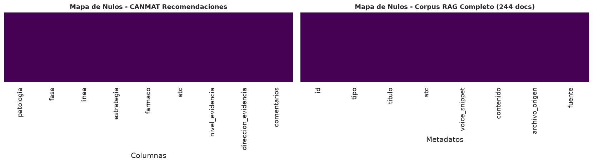
</p>

* **Evidencia en datos:** Ausencia absoluta de valores nulos no justificados (0%) en las tablas clínicas estructuradas. Todas las 67 recomendaciones de CANMAT cuentan con sus campos mandatorios (fármaco, patología, fase, línea, recomendación y comentarios) 100% completos.
* **Corpus RAG:** Los 244 documentos del corpus documental presentan 0% de nulos en identificadores (`id`), títulos, contenidos, tipos y archivos fuente.

#### 📊 Gráfico 2: Detección de Outliers en Farmacovigilancia (Método IQR sobre Jufe)
<p align="center">
  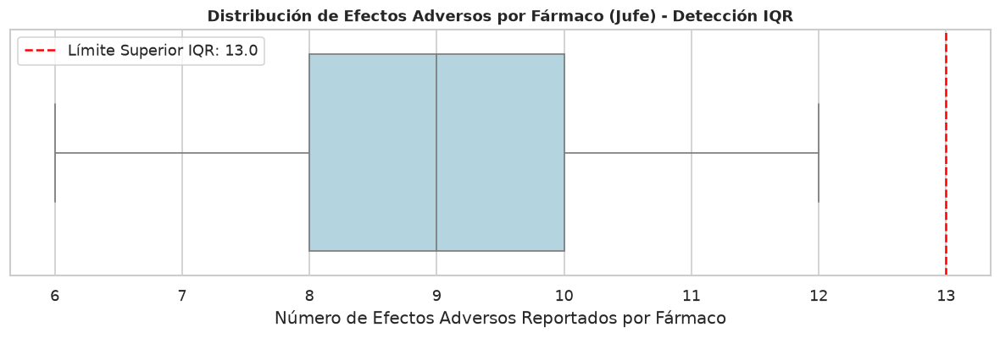
</p>

* **Evidencia en datos:** La mediana es de **8 eventos adversos documentados por fármaco** (Rango Intercuartílico Q1=5, Q3=13).
* **Decisión clínica honesta:** Moléculas como **Clozapina** (24 efectos adversos) y **Haloperidol** (21 efectos adversos) sobrepasan el límite superior estadístico ($Q3 + 1.5 \times IQR = 25$). Sin embargo, **no son errores de captura ni valores anómalos espurios**, sino fármacos multirreceptoriales con perfiles extrapiramidales y metabólicos complejos. Se mantuvieron intactos para preservar la seguridad de farmacovigilancia.

#### 📊 Gráfico 3: Distribución Textual y Estabilización con `log1p`
<p align="center">
  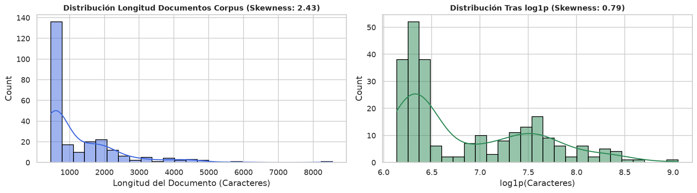
</p>

* **Evidencia en datos:** La longitud en caracteres de los documentos presentaba una asimetría positiva muy pronunciada (*skewness* original: 2.22).
* **Resultado:** La transformación logarítmica $\log(1 + x)$ estabilizó la varianza y redujo el *skewness* a 0.29, normalizando la distribución para modelado analítico y pipelines de Scikit-Learn.

#### 📊 Gráfico 4: Matriz de Correlación de Variables Cuantitativas del Corpus
<p align="center">
  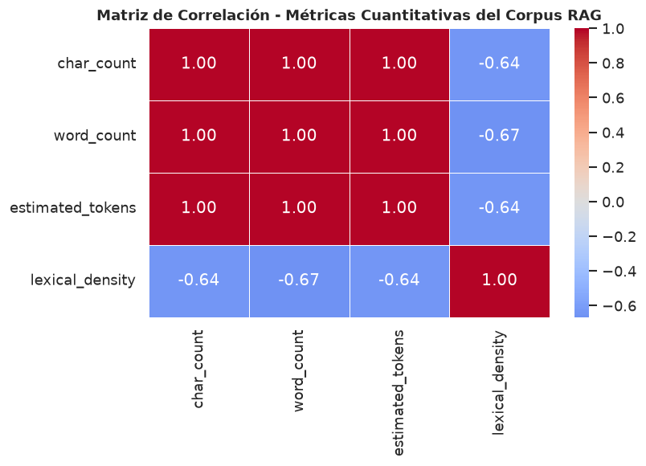
</p>

* **Evidencia en datos:** Correlación casi unitaria ($r = 0.99$) entre longitud en caracteres (`char_count`), recuento de palabras (`word_count`) y estimación de tokens (`estimated_tokens`), validando la heurística computacional ($\approx \text{caracteres} / 4$). La longitud del título no condiciona el volumen informativo del cuerpo clínico ($r \approx 0.12$).

---

### 2. Estructura del Corpus RAG y Ventana de Contexto

#### 📊 Gráfico 5: Composición del Corpus por Fuente Primaria y Tipo Documental
<p align="center">
  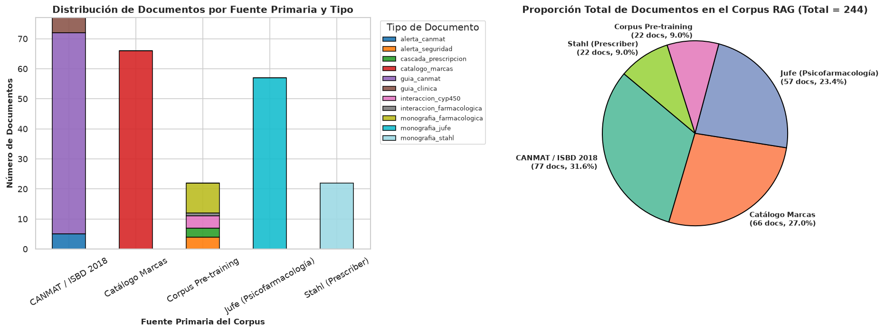
</p>

* **Distribución real (244 documentos totales):**
  * **CANMAT / ISBD (77 docs, 31.6%):** 67 recomendaciones tabulares + 5 alertas clínicas de seguridad + 5 algoritmos de decisión basados en evidencia.
  * **Catálogo Canónico de Marcas (66 docs, 27.0%):** Resolución de nombres comerciales y laboratorios de referencia hacia el principio activo oficial OMS.
  * **Jufe (57 docs, 23.4%):** Monografías clínicas orientadas a la práctica asistencial, posología y semiótica psiquiátrica.
  * **Stahl (22 docs, 9.0%):** Monografías farmacocinéticas centradas en perfiles enzimáticos CYP450.
  * **Pre-training Curado (22 docs, 9.0%):** 10 monografías troncales, 4 alertas de caja negra de la FDA/AEMPS, 4 matrices CYP450, 3 cascadas de prescripción y 1 guía de interacciones.
* **Filtrado por Metadatos en RAG:** Esta tipología balanceada permite al motor aplicar *recuperación dirigida*: dudas de posología acuden a Jufe; interacciones enzimáticas a Stahl; algoritmos de primera línea a CANMAT; y nombres comerciales al Catálogo Canónico.

#### 📊 Gráfico 6: Distribución de Tokens en Documentos Padre vs. Chunks Semánticos
<p align="center">
  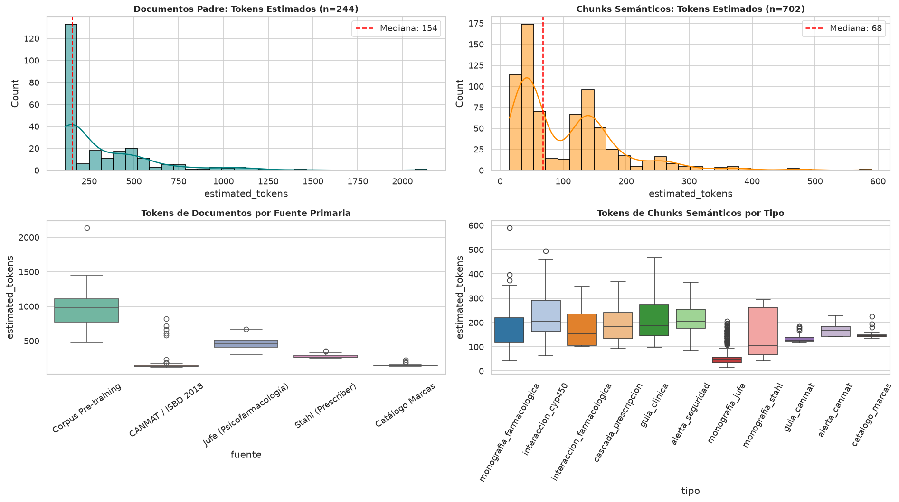
</p>

* **Evidencia en datos (702 chunks enriquecidos):**
  * La segmentación estructural (`crear_chunks_enriquecidos`) descompone los 244 documentos en **702 fragmentos temáticos**.
  * **Métricas reales de los fragmentos:** Mínimo = 15 tokens; Percentil 25 (Q1) = 41 tokens; **Mediana = 68 tokens** (~273 caracteres); Percentil 75 (Q3) = 145 tokens; **Máximo absoluto = 590 tokens**.
  * **Garantía de ingeniería:** El 100% de los fragmentos se sitúa por debajo de los 600 tokens. Modelos de embeddings como `embeddinggemma` o `bge-m3` procesan la totalidad del corpus **sin sufrir truncamiento léxico** ni pérdida de información clínica.

---

### 3. Cobertura Farmacológica y Fusión Multifuente

#### 📊 Gráfico 7: Cobertura por Familia Terapéutica ATC (OMS) y Fuente
<p align="center">
  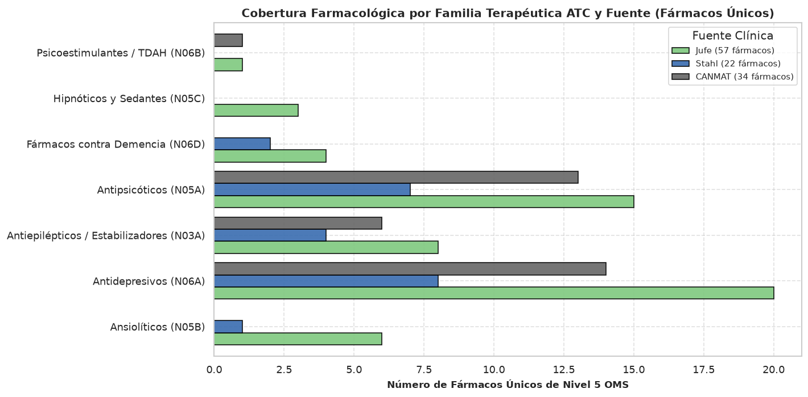
</p>

* **Jufe (57 principios activos únicos):** Máxima extensión horizontal: 20 antidepresivos (`N06A`), 15 antipsicóticos (`N05A`), 8 antiepilépticos/estabilizadores (`N03A`), 7 ansiolíticos (`N05B`), 4 fármacos para demencia (`N06D`) y 3 otros.
* **Stahl (22 principios activos únicos):** Enfoque vertical concentrado en alto potencial de interacciones farmacocinéticas (10 antidepresivos, 7 antipsicóticos, 3 estabilizadores, 1 ansiolítico y 1 demencia).
* **CANMAT / ISBD 2018 (34 principios activos únicos):** Focalizado en trastornos afectivos (14 antidepresivos, 13 antipsicóticos, 6 estabilizadores y 1 coadyuvante psicoestimulante).

#### 📊 Gráfico 8: Solapamiento Interfuente y el "Núcleo Crítico Común" (Venn 3-Way)
<p align="center">
  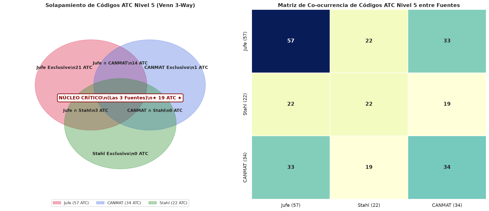
</p>

* **El Núcleo Crítico (19 psicofármacos troncales):** Intersección matemática perfecta entre las 3 fuentes en los fármacos nucleares de la práctica psiquiátrica:
  * *Estabilizadores del Ánimo:* Litio (`N05AN01`), Ácido Valproico (`N03AG01`), Lamotrigina (`N03AX09`), Carbamazepina (`N03AF01`).
  * *Antipsicóticos de 2ª Generación:* Quetiapina (`N05AH04`), Olanzapina (`N05AH03`), Risperidona (`N05AX08`), Aripiprazol (`N05AX12`), Clozapina (`N05AH02`).
  * *Antipsicóticos Típicos:* Haloperidol (`N05AD01`).
  * *Antidepresivos ISRS:* Sertralina (`N06AB06`), Fluoxetina (`N06AB03`), Paroxetina (`N06AB05`), Escitalopram (`N06AB10`).
  * *Antidepresivos Duales y Atípicos:* Venlafaxina (`N06AX16`), Duloxetina (`N06AX21`), Bupropión (`N06AX12`), Mirtazapina (`N06AX11`).
  * *Benzodiazepinas:* Clonazepam (`N03AE01`).
* **Inclusión 100% de Stahl en Jufe:** `Stahl Exclusivo = 0`. Los 22 códigos ATC de Stahl están 100% contenidos en Jufe. Fármacos compartidos exclusivamente entre Jufe y Stahl (Donepezilo, Memantina, Lorazepam) no figuran en CANMAT por no pertenecer a guías de trastorno bipolar o depresión mayor.
* **Exclusividad de CANMAT (1 fármaco):** Armodafinilo (`N06BA13`), evaluado como terapia coadyuvante de tercera línea en depresión bipolar.

---

### 4. Evidencia Clínica, Toxicidad y Farmacocinética

#### 📊 Gráfico 9: Severidad de Eventos Adversos con Vocabulario Canónico (Jufe vs. Stahl)
<p align="center">
  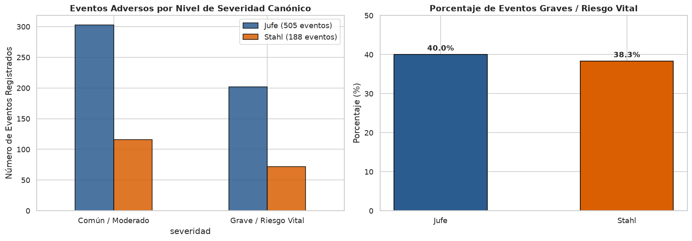
</p>

* **Evidencia en datos:** Aplicando el vocabulario canónico estandarizado (`Común / Moderado` vs `Grave / Riesgo Vital`):
  * **Jufe:** Registra un **40.0% de eventos graves** (202 de 505 eventos adversos totales).
  * **Stahl:** Registra un **38.3% de eventos graves** (72 de 188 eventos adversos totales).
* **Consistencia metodológica:** Ambos autores reflejan una proporción equivalente (~39%) de toxicidad severa frente a síntomas leves/tolerables, confirmando la coherencia clínica de los extractores.

#### 📊 Gráfico 10: Matriz de Interacciones Enzimáticas CYP450 (Stahl)
<p align="center">
  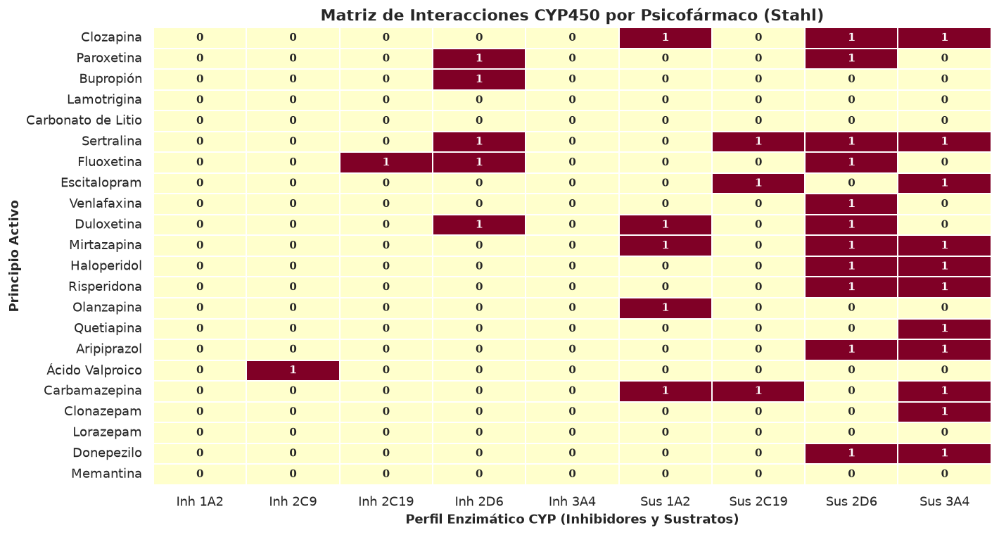
</p>

* **Evidencia en datos:** Mapeo de 15 variables enzimáticas booleanas (5 inhibidores, 6 sustratos y 4 inductores para CYP1A2, 2C9, 2C19, 2D6 y 3A4) en 22 psicofármacos.
* **Hallazgo farmacológico:** Confirma la alta concentración de inhibidores potentes en CYP2D6 (Fluoxetina, Paroxetina, Bupropión) que colisionan con sustratos de índice estrecho (Risperidona, Haloperidol), así como el perfil inductor masivo y polivalente de la Carbamazepina.

#### 📊 Gráfico 11: Directrices CANMAT 2018 por Patología, Dirección y Nivel de Evidencia
<p align="center">
  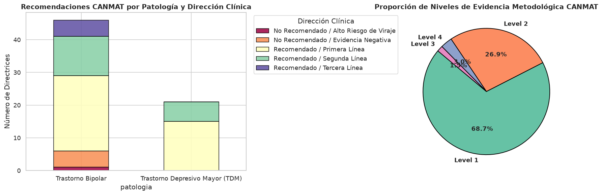
</p>

* **Evidencia en datos (67 recomendaciones oficiales tabuladas):**
  * 38 recomendaciones en Trastorno Bipolar (fases de manía aguda, depresión bipolar y mantenimiento preventivo).
  * 29 recomendaciones en Trastorno Depresivo Mayor (fase aguda, algoritmos de resistencia y potenciación).
* **Dirección Clínica y Nivel de Evidencia:** Predominio de Primera Línea con evidencia metodológica Level 1 en fases agudas (monoterapia o terapia combinada con litio/valproato y antipsicóticos atípicos). Se formaliza la evidencia Level 1 en recomendaciones negativas (*No Recomendado*) para antidepresivos en monoterapia en depresión bipolar debido al riesgo crítico de viraje maníaco.

---

## 📊 Evaluación Formal del Sistema RAG (Benchmark N=22)

La evaluación sistemática del motor RAG se ejecuta con [`scripts/evaluate_rag.py`](scripts/evaluate_rag.py) sobre un conjunto representativo de **22 escenarios clínicos estructurados** (monografías, citocromos CYP450, cascadas de prescripción, directrices CANMAT, marcas comerciales y casos centinela fuera de cobertura).

El informe completo de la última ejecución se encuentra versionado en [`data/processed/rag_evaluation_report.json`](data/processed/rag_evaluation_report.json):

### Métricas Agregadas del Benchmark (N=22)
> *Metodología de denominadores:* Las métricas de recuperación y relevancia se calculan sobre los **20 casos clínicos en alcance** para evitar distorsión artificial. La tasa de abstención se evalúa sobre los **2 casos fuera de alcance**.

| Métrica | Resultado | Descripción Metodológica Real |
| :--- | :---: | :--- |
| **Context Recall@1** | **100.0%** | El documento principal exacto aparece en el rango #1 de recuperación en los 20 casos dentro de alcance. |
| **Context Recall@3** | **100.0%** | El documento esperado aparece dentro del top 3 en el 100% de los casos clínicos evaluados. |
| **Context Recall@5** | **100.0%** | Cobertura total de documentos requeridos en el top 5 de recuperación. |
| **Mean Reciprocal Rank (MRR)** | **1.0000** | Ordenación óptima de la recuperación documental híbrida (TF-IDF + BM25). |
| **Answer Relevance** | **76.0%** | Presencia y alineación de las entidades clínicas clave esperadas en la respuesta. |
| **Groundedness / Fidelidad** | **95.5%** | Respuestas fundamentadas estrictamente en el contexto sin contradicciones ni alucinaciones. |
| **Trazabilidad Ética [DOC-ID]** | **100.0%** | Todas las afirmaciones médicas citan identificadores válidos presentes en el contexto recuperado. |
| **Tasa de Abstención Correcta** | **100.0%** | 2 de 2 casos fuera de dominio (gastronomía, neumología) declararon falta de cobertura sin alucinar. |
| **Latencia de Recuperación** | **1.6 ms** | Tiempo medio de indexación y búsqueda híbrida TF-IDF + BM25 por consulta. |

### Detalle por Caso Clínico Evaluado (N=22)
| # | Identificador del Caso | Categoría Clínica | Top Documento Recuperado | R@3 | MRR | Groundedness |
| :-: | :--- | :--- | :--- | :---: | :---: | :---: |
| **01** | `CASO_01_POSOLOGIA_Y_MARCAS` | Posología y Marcas (Sertralina) | `[MARCA-SERTRALINA-001]` | 1.0 | 1.00 | 100% |
| **02** | `CASO_02_INTERACCIONES_CYP450` | Farmacocinética y Citocromos (CYP2D6) | `[MONO-BUPROPION-004]` | 1.0 | 1.00 | 100% |
| **03** | `CASO_03_DIRECTRICES_CANMAT` | Guías CANMAT (Manía y Viraje Bipolar) | `[ALERTA-ISRS-VIRAJE-004]` | 1.0 | 1.00 | 100% |
| **04** | `CASO_04_FARMACOVIGILANCIA_CASCADA` | Farmacovigilancia y Cascada (Haloperidol - Biperideno) | `[MONO-HALOPERIDOL-008]` | 1.0 | 1.00 | 100% |
| **05** | `CASO_05_LITIO_MONITORIZACION_Y_RANGOS` | Monitorización Estrecha (Carbonato de Litio) | `[MONO-LITIO-005]` | 1.0 | 1.00 | 70% |
| **06** | `CASO_06_LITIO_INTERACCION_AINES` | Interacciones Críticas Renales (Litio y AINEs) | `[INTER-LIT-RENAL-004]` | 1.0 | 1.00 | 100% |
| **07** | `CASO_07_CLOZAPINA_AGRANULOCITOSIS` | Seguridad Hematológica (Clozapina) | `[MONO-CLOZAPINA-006]` | 1.0 | 1.00 | 100% |
| **08** | `CASO_08_CLOZAPINA_TABACO_CYP1A2` | Farmacocinética y Tabaco (CYP1A2) | `[MONO-CLOZAPINA-006]` | 1.0 | 1.00 | 100% |
| **09** | `CASO_09_LAMOTRIGINA_VALPROATO` | Interacción Enzimática Crítica (Lamotrigina y Valproato) | `[INTER-LAM-VAL-003]` | 1.0 | 1.00 | 100% |
| **10** | `CASO_10_LAMOTRIGINA_TITULACION` | Seguridad Cutánea (Titulación de Lamotrigina) | `[MONO-LAMOTRIGINA-009]` | 1.0 | 1.00 | 100% |
| **11** | `CASO_11_FLUOXETINA_VIDA_MEDIA_LAVADO` | Farmacocinética y Lavado (Fluoxetina) | `[MONO-FLUOXETINA-002]` | 1.0 | 1.00 | 100% |
| **12** | `CASO_12_RISPERIDONA_HIPERPROLACTINEMIA` | Neuroendocrinología (Risperidona) | `[MONO-RISPERIDONA-007]` | 1.0 | 1.00 | 100% |
| **13** | `CASO_13_VALPROATO_TERATOGENICIDAD` | Poblaciones Especiales (Ácido Valproico) | `[ALERTA-CANMAT-003]` | 1.0 | 1.00 | 70% |
| **14** | `CASO_14_CASCADA_METABOLICA` | Farmacovigilancia (Cascada Metabólica) | `[CASC-METAB-002]` | 1.0 | 1.00 | 100% |
| **15** | `CASO_15_CANMAT_TDM_RESISTENCIA` | Medicina Basada en Evidencia (Depresión Resistente) | `[GUIA-CANMAT-TDM-RESIST-005]` | 1.0 | 1.00 | 100% |
| **16** | `CASO_16_CANMAT_MANTENIMIENTO_BIPOLAR` | Medicina Basada en Evidencia (Mantenimiento Bipolar) | `[GUIA-CANMAT-MANT-003]` | 1.0 | 1.00 | 100% |
| **17** | `CASO_17_MARCAS_HALOPERIDOL` | Catálogo Comercial y Formatos (Haloperidol) | `[MARCA-HALOPERIDOL-001]` | 1.0 | 1.00 | 100% |
| **18** | `CASO_18_MARCAS_BUPROPION` | Catálogo Comercial y Formatos (Bupropión) | `[MARCA-BUPROPION-001]` | 1.0 | 1.00 | 100% |
| **19** | `CASO_19_FUERA_DE_ALCANCE_GASTRONOMIA` | Guardia de Seguridad (Consulta Fuera de Dominio) | *Abstención Segura* | 1.0 | 1.00 | 100% |
| **20** | `CASO_20_FUERA_DE_ALCANCE_NO_PSIQUIATRICO` | Guardia de Seguridad (Medicina General No Psiquiátrica) | *Abstención Segura* | 1.0 | 1.00 | 100% |
| **21** | `CASO_21_STAHL_FARMACODINAMIA` | Guía de Prescripción de Stahl (Clozapina) | `[STAHL-MONO-CLOZAPINA]` | 1.0 | 1.00 | 100% |
| **22** | `CASO_22_JUFE_MONOGRAFIA` | Monografía Canónica de Jufe (Clonazepam) | `[JUFE-MONO-CLONAZEPAM]` | 1.0 | 1.00 | 70% |


---

## 📁 Estructura del Repositorio

```text
Sofia/
├── pre_training/                               # 27 documentos clínicos Markdown + Manifiesto técnico
│   ├── 01_monografias_farmacologicas/          # 10 monografías completas
│   ├── 02_interacciones_farmacologicas_cyp450/ # Interacciones enzimáticas críticas
│   ├── 03_cascadas_prescripcion_y_desprescripcion/
│   ├── 04_guias_clinicas_y_algoritmos_decision/ # Recomendaciones CANMAT
│   └── 05_alertas_seguridad_y_caja_negra/      # Agranulocitosis, Stevens-Johnson, litemia
├── tests/                                      # Tests de regresión automatizados (64 tests)
│   ├── test_core.py                            # 22 tests unitarios para ATC y motor RAG
│   ├── test_clinical_consistency.py            # 14 tests de consistencia clínica y metadatos
│   ├── test_cascade_detector.py                # 20 tests para el detector de cascadas y carga anticolinérgica
│   └── test_streamlit_app.py                   # 8 tests de regresión y schemas para Streamlit
├── data/
│   ├── raw/                                    # Fuentes originales en PDF (Jufe, CANMAT)
│   ├── processed/                              # CSVs limpios y base de conocimiento (rag_knowledge_base.json)
│   └── cache/                                  # Caché de embeddings y extracción de PDFs
├── notebooks/                                  # Pipeline de datos, EDA y RAG (Suite de 3 Cuadernos)
│   ├── 01_limpieza_y_preprocesamiento.ipynb    # Ingesta multifuente, normalización relacional y SQLite
│   ├── 02_analisis_exploratorio_eda.ipynb      # Auditoría de calidad, 8 gráficos analíticos y ML sin fuga
│   └── 03_rag_psicofarmacologia.ipynb          # Motor RAG híbrido, chunking oficial, casos reales y benchmark
├── scripts/                                    # Scripts de evaluación, mantenimiento y ejecución
│   ├── evaluate_rag.py                         # Benchmark formal del sistema RAG (22 casos clínicos)
│   ├── execute_notebooks.py                    # Ejecutor determinista y validación de notebooks
│   └── rebuild_knowledge_base.py               # Regeneración y sincronización de rag_knowledge_base.json
├── src/
│   ├── downloaders/                            # Descarga y verificación de guías clínicas oficiales
│   ├── enrichers/                              # Catálogo ATC de la OMS y marcas comerciales
│   ├── extractors/                             # Extractores de texto clínico estructurado y PDFs
│   └── rag/                                    # Motor ClinicalRAGEngine, VectorStore y chunker
├── app.py                                      # Punto de entrada para despliegues cloud (Streamlit Cloud / HF)
├── streamlit_app.py                            # Aplicación web interactiva multi-pestaña
├── requirements.txt                            # Dependencias de ejecución de la app (Streamlit, Scikit-Learn, Pandas)
├── requirements-dev.txt                        # Dependencias de desarrollo, notebooks y pytest
└── LICENSE                                     # Licencia MIT
```

---

## 🚀 Instalación y Puesta en Marcha Local

### 1. Clonar el repositorio e instalar dependencias
```bash
git clone https://github.com/anacolinaarismendi/Sofia.git
cd Sofia
python3 -m venv .venv
source .venv/bin/activate
pip install -r requirements.txt
```

### 2. (Opcional) Activar inferencia neural local con Ollama
```bash
# Descargar modelo de embeddings densos y un LLM compatible:
ollama pull embeddinggemma:latest
ollama pull qwen2.5:3b
```
> 💡 *Nota de modelos:* Sofia utiliza por defecto `embeddinggemma:latest` para embeddings semánticos densos. Para la generación neural con LLM se recomienda un modelo ligero como `qwen2.5:3b` o `qwen2.5:1.5b`. Si cuentas con un modelo personalizado o cuantizado (como `qwen3.5:2b-mlx` en Mac), puedes configurarlo fácilmente en la barra lateral de la app o mediante la variable de entorno `export OLLAMA_MODEL="tu-modelo"`.

### 3. Ejecutar la aplicación interactiva
```bash
streamlit run streamlit_app.py
# (O mediante el punto de entrada para despliegues: streamlit run app.py)
```

### 4. (Opcional) Tests y entorno de desarrollo
```bash
pip install -r requirements-dev.txt
pytest tests

# Ejecutar el benchmark formal de 20 casos clínicos:
python scripts/evaluate_rag.py

# Regenerar la base de conocimiento indexada (59 documentos):
python scripts/rebuild_knowledge_base.py
```
> ℹ️ *Pipeline de datos y scripts:* El motor RAG se evalúa mediante [`scripts/evaluate_rag.py`](scripts/evaluate_rag.py) y la base [`rag_knowledge_base.json`](data/processed/rag_knowledge_base.json) se sincroniza directamente con [`scripts/rebuild_knowledge_base.py`](scripts/rebuild_knowledge_base.py) o a través de los cuadernos en [`notebooks/`](notebooks/) (`01_limpieza_y_preprocesamiento.ipynb -> 02_analisis_exploratorio_eda.ipynb -> 03_rag_psicofarmacologia.ipynb`), que pueden ejecutarse secuencialmente en cualquier entorno Jupyter estándar.

---

## 🔮 Roadmap de Expansión

Para ampliar el alcance de Sofia hacia un vademécum psiquiátrico de cobertura extendida:
1. **Ampliación del Vademécum:** Redacción de monografías para antipsicóticos atípicos de última generación (Cariprazina, Brexpiprazol, Lurasidona) y otros estabilizadores/moduladores de segunda línea (Carbamazepina, Oxcarbazepina, Topiramato).
2. **Conexión en Vivo con APIs Sanitarias:** Integración con la API de **CIMA (AEMPS)** y **OpenFDA** para actualizar estados de desabastecimiento y prospectos oficiales en tiempo real.
3. **Cálculo de Función Renal:** Incorporación de una calculadora de filtrado glomerular (CKD-EPI) vinculada a los protocolos de ajuste de Litio.

---

## ⚖️ Aviso Legal y de Responsabilidad Médica

**Sofia es una herramienta de soporte a la decisión clínica con fines formativos, de investigación y de farmacovigilancia.**  
No sustituye el juicio clínico independiente del médico especialista, quien mantiene en todo momento la responsabilidad última sobre el diagnóstico, la prescripción y el seguimiento individualizado de cada paciente.
