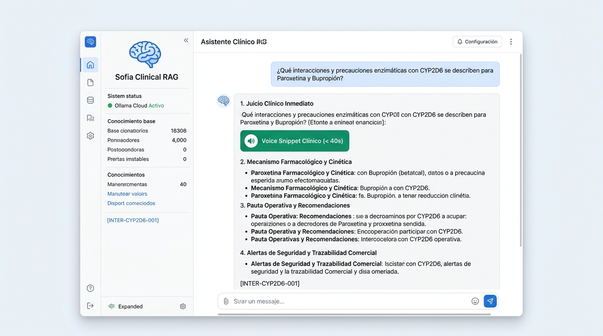
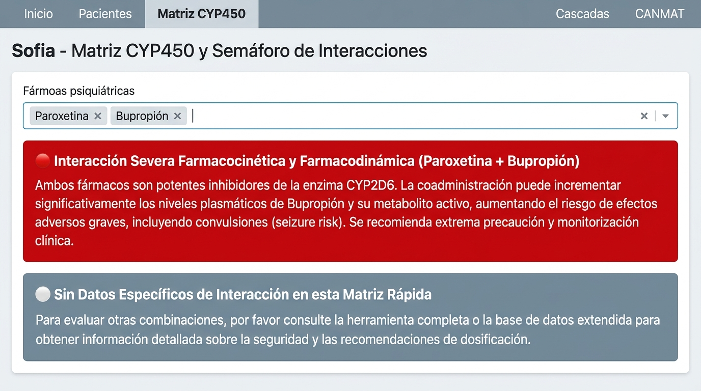
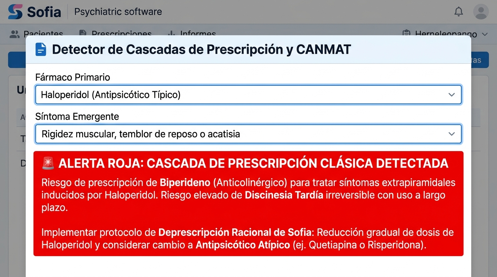

# Sofia — Asistente Clínico Inteligente y RAG de Psicofarmacología

[](https://appapppy-olzne8ryns9sw9j6dc6rbw.streamlit.app)
[](https://www.python.org/)
[](LICENSE)
[-blue.svg)](data/processed/rag_evaluation_report.json)

> 🚀 **Aplicación Web Desplegada en Streamlit Cloud:** [appapppy-olzne8ryns9sw9j6dc6rbw.streamlit.app](https://appapppy-olzne8ryns9sw9j6dc6rbw.streamlit.app)

---

## 📌 ¿Qué es Sofia y cuál es el alcance real de su RAG?

**Sofia** es un sistema de soporte a la decisión clínica, farmacovigilancia y generación aumentada por recuperación (RAG) especializado en **psicofarmacología basada en la evidencia**.

Para garantizar la seguridad médica y evitar alucinaciones, **Sofia opera bajo una política de *Grounding Estricto*:**
> **El modelo responde únicamente en base a los 27 documentos clínicos curados en [`pre_training/`](pre_training/) y a las tablas estructuradas de [`data/processed/`](data/processed/)** (la base indexada, [`rag_knowledge_base.json`](data/processed/rag_knowledge_base.json), contiene 59 documentos: los 27 curados + 22 fichas de recomendaciones CANMAT + 10 fichas de marcas comerciales y laboratorios).  
> Si una consulta excede este corpus, el sistema **declara explícitamente su limitación**: con recuperación léxica (TF-IDF + BM25) lo hace mediante un umbral mínimo de similitud (heurística, puede fallar en consultas ambiguas) y, con LLM, mediante el prompt de *grounding estricto*. Las citas `[DOC-ID]` de las respuestas del LLM se validan contra los documentos recuperados y se avisa si alguna no figura.

---

## 🎯 Capacidades Reales: Qué SÍ puede responder el RAG

El motor RAG cuenta con información detallada, validada y estructurada para responder con alto rigor científico a preguntas en las siguientes cinco áreas:

### 1. Monografías y Posología de 10 Psicofármacos Clave
Cada una de las siguientes moléculas dispone de una monografía completa (mecanismo neuroquímico, afinidad de receptores, rangos de dosificación según Jufe y Stahl, efectos comunes vs. graves y poblaciones especiales):

| Principio Activo | Clase Terapéutica | Código ATC | Rango Terapéutico Usual | Aspectos Específicos Indexados |
| :--- | :--- | :---: | :---: | :--- |
| **Sertralina** | Antidepresivo ISRS | `N06AB06` | 50 – 200 mg/día | Cardiopatía isquémica (estudio SADHART), marcas y laboratorios. |
| **Fluoxetina** | Antidepresivo ISRS | `N06AB03` | 20 – 60 mg/día | Vida media prolongada (norfluoxetina), antagonismo 5-HT2C, lavado IMAO. |
| **Paroxetina** | Antidepresivo ISRS | `N06AB05` | 20 – 50 mg/día | Perfil anticolinérgico M1, sedación, síndrome de discontinuación intenso. |
| **Bupropión** | Antidepresivo IRND | `N06AX12` | 150 – 300 mg/día | Cero impacto sexual/peso, metabolismo CYP2B6, umbral convulsivo. |
| **Haloperidol** | Antipsicótico Típico ($D_2$) | `N05AD01` | 2 – 15 mg/día | Síntomas extrapiramidales agudos, riesgo QTc, cascada con biperideno. |
| **Risperidona** | Antipsicótico Atípico | `N05AX08` | 2 – 6 mg/día | Metabolismo CYP2D6 hacia 9-OH-risperidona, hiperprolactinemia. |
| **Clozapina** | Antipsicótico Atípico | `N05AH02` | 300 – 600 mg/día | Dependencia de CYP1A2 (efecto tabaco), protocolo de agranulocitosis. |
| **Carbonato de Litio**| Estabilizador del Ánimo | `N05AN01` | Litemia: 0.6–1.0 mEq/L | Eliminación renal exclusiva, litemias tóxicas (>1.5 mEq/L), AINEs/tiazidas. |
| **Lamotrigina** | Estabilizador / Antiepiléptico | `N03AX09` | 100 – 200 mg/día | Glucuronidación UGT1A4, titulación lenta, prevención de Stevens-Johnson. |
| **Ácido Valproico / Divalproato** | Estabilizador / Antiepiléptico | `N03AG01` | 750 – 2000 mg/día (Valproemia: 50–100 µg/mL) | Inhibición potente de UGT1A4 (duplica lamotrigina), teratogenicidad (contraindicado en embarazo), controles hepáticos y plaquetarios. |

*(Nota: Fármacos adicionales como Quetiapina, Olanzapina, Aripiprazol, Escitalopram, Citalopram, Venlafaxina o Duloxetina están indexados en las tablas CANMAT y el catálogo ATC, pero no cuentan con una monografía de texto largo independiente).*

### 2. Interacciones Enzimáticas del Citocromo P450 y Aclaramiento Renal
El RAG explica el mecanismo molecular y la conducta clínica esperada ante:
- **Inhibición de CYP2D6:** Impacto de inhibidores potentes (Paroxetina, Bupropión, Fluoxetina) sobre sustratos de índice estrecho (Risperidona, Haloperidol).
- **Metabolismo de CYP1A2 y Clozapina:** Elevación tóxica de clozapina ante el cese del consumo de tabaco (los hidrocarburos inducen 1A2) o coadministración de inhibidores.
- **Glucuronidación (UGT1A4) de Lamotrigina:** Duplicación de niveles plasmáticos al asociarse con Ácido Valproico y necesidad de reducir la dosis inicial en $\ge 50\%$.
- **Toxicidad Lítica por Aclaramiento Renal:** Disminución del filtrado de Litio provocada por AINEs (ibuprofeno, naproxeno), diuréticos tiazídicos e IECA.

### 3. Detección de Cascadas de Prescripción y Desprescripción
Identificación del patrón donde el efecto adverso de un psicofármaco se confunde con una nueva enfermedad:
- **Haloperidol $\to$ Parkinsonismo $\to$ Biperideno:** Alerta sobre carga anticolinérgica, riesgo de discinesia tardía irreversible y deterioro cognitivo; recomienda ajuste de dosis o rotación a atípicos.
- **Clozapina $\to$ Sialorrea nocturna:** Protocolo con medidas locales (atropina sublingual) frente al uso erróneo de anticolinérgicos orales sistémicos.
- **Litio $\to$ Poliuria:** Alerta crítica de contraindicación de diuréticos tiazídicos para tratar la diabetes insípida nefrogénica inducida por litio.

### 4. Guías Internacionales CANMAT / ISBD 2018
Recomendaciones oficiales tabuladas por líneas de tratamiento y niveles de evidencia científica (Level 1 a Level 4):
- **Trastorno Bipolar (Manía Aguda):** Fármacos de primera línea (Litio, Quetiapina, Divalproato, combinaciones).
- **Trastorno Bipolar (Depresión Bipolar):** Primera línea (Quetiapina, Lurasidona) y **alerta de viraje maníaco** (contraindicación formal Level 1 de daño para ISRS en monoterapia).
- **Trastorno Depresivo Mayor (TDM):** Fases agudas y algoritmos de potenciación en resistencia (ej. adición de Aripiprazol o Litio).

### 5. Trazabilidad Comercial y Clasificación ATC (OMS)
- Mapeo directo a códigos anatómicos oficiales de la OMS.
- Nombres comerciales y laboratorios de referencia en España y Latinoamérica (ej. *Zoloft, Serlift, Prozac, Paxil, Wellbutrin, Leponex, Haldol, Plenur, Lamictal*).

---

## ⚠️ Fronteras y Límites: Qué NO puede responder el RAG

Para mantener expectativas realistas sobre el sistema interactivo, el usuario debe tener en cuenta lo siguiente:

| Categoría de Consulta | Capacidad del RAG | Razón / Comportamiento del Sistema |
| :--- | :---: | :--- |
| **Psicofármacos no indexados en monografía** *(ej. Clonazepam, Lorazepam, Mirtazapina, Cariprazina, Trazodona)* | ❌ Limitada | Si el principio activo no está en `pre_training/`, el modelo declarará no tener suficiente contexto clínico para emitir una recomendación segura. |
| **Medicina General / No Psiquiátrica** *(ej. antibióticos, oncología, antihipertensivos generales)* | ❌ Fuera de alcance | El corpus está restringido a psicofármacos y a interacciones directas con ellos (como AINEs/IECA con Litio). |
| **Diagnóstico Psicopatológico Puro** *(ej. criterios diagnósticos DSM-5/CIE-11 desvinculados de la medicación)* | ❌ No diseñado | Sofia es un asesor psicofarmacológico, no una herramienta de entrevista o diagnóstico clínico formal. |
| **Psicoterapia y Abordajes no Farmacológicos** | ❌ No disponible | No incluye protocolos de terapia cognitivo-conductual, psicoanálisis o terapias de tercera generación. |
| **Cálculo de Aclaramiento Dinámico de Creatinina** | ⚠️ Orientativo | Puede indicar la necesidad de ajuste renal según la monografía, pero no calcula ecuaciones dinámicas (Cockcroft-Gault / CKD-EPI) a partir de valores sueltos de laboratorio. |
| **Consultas Abiertas sin Evidencia en el Corpus** | 🛡️ Grounding Estricto | Umbral de similitud en modo TF-IDF (mensaje de "sin cobertura") y prompt que prohíbe inventar datos ausentes del contexto. La detección léxica es heurística, no infalible. |

---

## ⚙️ Modos de Inferencia en la App Interactiva

El motor [`ClinicalRAGEngine`](src/rag/engine.py) implementa una arquitectura híbrida con dos vías de ejecución según la disponibilidad de recursos y conectividad:

```mermaid
flowchart TD
    Q["Consulta del Usuario"] --> VS["ClinicalVectorStore (Recuperación top_k=3)"]
    VS -->|Ollama Activo (Local o Cloud API)| V_Densa["Búsqueda Semántica Densa (embeddinggemma)"]
    VS -->|Ollama Inactivo / Sin API Key| V_TFIDF["Búsqueda Léxica TF-IDF Scikit-Learn (ngram 1,2)"]
    
    V_Densa --> Ctx["Ensamblado de Contexto con Identificadores [DOC-ID]"]
    V_TFIDF --> Ctx
    
    Ctx --> LLM_Check{"¿Servidor LLM Disponible?"}
    LLM_Check -->|Sí: Ollama Local / Cloud API| Gen_LLM["Generación Neural Estructurada en 4 Apartados<br>(qwen3.5:2b-mlx / T=0.2)"]
    LLM_Check -->|No: Contingencia Sin LLM| Gen_Det["Plantilla Fija de Texto (4 frases hardcoded)<br>rellenada con la Ficha Recuperada"]
    
    Gen_LLM --> Resp["Respuesta Clínica Dinámica + Voice Snippet + Fuentes [DOC-ID]"]
    Gen_Det --> Resp
```

### 1. Modo Neural Completo (Ollama Local o Cloud API)
- **Embeddings:** `embeddinggemma:latest` para búsqueda semántica vectorial densa basada en significado clínico.
- **LLM:** `qwen3.5:2b-mlx` (temperatura 0.2) con el prompt clínico de Sofia (`SOFIA_CLINICAL_PROMPT`).
- **Salida:** Respuesta clínica redactada dinámicamente en 4 apartados estructurados, razonando sobre el caso concreto, citando identificadores `[DOC-ID]` y extrayendo el *Voice Snippet* (<40s).
- 📱 **Requisito en ordenadores básicos, teléfonos móviles o Streamlit Cloud:**  
  Un teléfono móvil o un servidor web gratuito sin GPU (como Streamlit Community Cloud) **no puede correr `qwen` ni `embeddinggemma` localmente**. Si se abre la aplicación desde un teléfono o a través de internet sin hardware dedicado, **se necesita obligatoriamente conexión y una API Key de Ollama Cloud** (o un servidor Ollama remoto accesible) para que el modelo de lenguaje pueda redactar y responder.
  
  > 🔐 **Cómo configurar la clave en Streamlit Cloud:**
  > 1. Obtén tu API Key gratuita en [ollama.com/settings/keys](https://ollama.com/settings/keys).
  > 2. En tu panel de [Streamlit Community Cloud](https://share.streamlit.io), entra a la app y pulsa **Settings → Secrets**.
  > 3. Pega la configuración basada en [`.streamlit/secrets.toml.example`](.streamlit/secrets.toml.example):
  >    ```toml
  >    OLLAMA_API_KEY = "tu_ollama_api_key_aqui"
  >    OLLAMA_HOST = "https://ollama.com"
  >    OLLAMA_MODEL = "qwen2.5:7b"
  >    ```
  > 4. Guarda los cambios para que Sofia active el modelo generativo en la nube.


### 2. Modo Contingencia (Sin servidor LLM / Fallback Scikit-Learn)
- **¿Qué significa que "el modelo conmuta a contingencia"?:**  
  En este modo **no hay ningún modelo de lenguaje en ejecución**. La generación neural está completamente inactiva. En su lugar, el sistema recurre a un **algoritmo estadístico clásico de búsqueda de palabras (TF-IDF de Scikit-Learn)** que simplemente busca coincidencias léxicas exactas de términos en los archivos Markdown.
- **¿Qué responde en contingencia?:**  
  No hay redacción ni razonamiento clínico. El sistema devuelve una **plantilla estática fija de 4 frases predefinidas (hardcoded en el código)** que rellena con el título y el resumen pregrabado del documento recuperado (`"Seguir la dosificación descrita en [DOC-ID]"`). No responderá dudas médicas personalizadas ni interpretará combinaciones farmacológicas que no estén escritas literalmente.
- **¿Qué significa que "nunca se rompe"?:**  
  Esta afirmación aplica **exclusivamente a nivel de estabilidad de software:** gracias a los bloques de captura de excepciones (`try...except`), la aplicación web **no lanza una pantalla roja de error de Python** (`ConnectionRefusedError` o `Timeout`) ante la caída del servidor. Sin embargo, a nivel funcional y de experiencia de usuario, **el modelo generativo no está activo** y el chat funciona como un simple visor rígido de fichas.

---

## 🖥️ Módulos de la Aplicación Web (`streamlit_app.py`)

La aplicación interactiva divide sus capacidades en cuatro pestañas especializadas:

### 1. 💬 Asistente RAG Clínico
Chat en lenguaje natural con respuestas médicas estructuradas en 4 secciones obligatorias (*Juicio Clínico, Mecanismo y Cinética, Pauta Operativa, Alertas de Seguridad*), tarjeta de *Voice Snippet* verbalizable (< 40s) y panel desplegable de documentos clínicos recuperados con citación trazable `[DOC-ID]`.

<p align="center">
  
</p>

### 2. ⚡ Matriz Interactiva CYP450
Selector múltiple de psicofármacos que evalúa combinaciones simultáneas mediante un semáforo clínico determinista de interacciones enzimáticas (bloqueos e inhibición potente de CYP2D6, duplicidad de ISRS, neurotoxicidad lítica, advertencias críticas de Clozapina con tabaco y Lamotrigina con Ácido Valproico).

<p align="center">
  
</p>

### 3. 🛑 Detector de Cascadas de Prescripción
Selector de fármaco primario prescrito más síntoma emergente reportado. Identifica cuándo un efecto adverso es interpretado erróneamente como una nueva patología (ej. haloperidol induciendo parkinsonismo) y despliega el protocolo clínico de desprescripción y desescalada.

<p align="center">
  
</p>

### 4. 📖 Guías CANMAT y Catálogo
Explorador interactivo de las directrices CANMAT e ISBD con filtros jerárquicos por patología (Trastorno Depresivo Mayor vs. Trastorno Bipolar), líneas de tratamiento y niveles de evidencia científica (Level 1 a Level 4), complementado con un buscador rápido de marcas comerciales y códigos ATC oficiales de la OMS.

---

## 🔬 Análisis Exploratorio de Datos (EDA) y Hallazgos Clínicos

El cuaderno [`notebooks/00_limpieza_y_eda.ipynb`](notebooks/00_limpieza_y_eda.ipynb) consolida la auditoría de calidad, la normalización relacional y el análisis estadístico sobre las fuentes clínicas primarias (Jufe, Stahl y CANMAT 2018). De este proceso se derivaron decisiones arquitectónicas determinantes para el sistema:

### Hallazgos Clínicos Principales
1. **Asimetría de Riesgo en CYP2D6:** Se constató una alta concentración de inhibidores potentes (Paroxetina, Bupropión, Fluoxetina) coadministrados frecuentemente con sustratos de índice estrecho (Risperidona, Haloperidol), con riesgo inminente de toxicidad extrapiramidal severa.
2. **Evidencia de Daño (CANMAT Level 1):** Identificación formal de la contraindicación absoluta de antidepresivos ISRS en monoterapia en Depresión Bipolar por riesgo probado de viraje maníaco y ciclación rápida.
3. **Vía No Citocromal del Litio:** El aclaramiento del carbonato de litio es 100% renal; las interacciones críticas derivan de fármacos no psiquiátricos masivos (AINEs como ibuprofeno, diuréticos tiazídicos e IECA) que reducen la filtración y provocan intoxicación lítica.
4. **Aislamiento de Alertas Potencialmente Letales:** Detección de 4 eventos de severidad máxima: agranulocitosis (Clozapina), Síndrome de Stevens-Johnson (Lamotrigina), toxicidad por litemia (Litio) y viraje a manía (ISRS en bipolar).

### Decisiones de Diseño y Procesamiento
- **Normalización Fonética y Léxica:** Implementación de normalización Unicode NFKD sin tildes para principios activos y marcas, eliminando fallos en coincidencias parciales ("Bupropión" vs. "bupropion").
- **Matriz Determinista Previa:** Incorporación de un semáforo interactivo precomputado en Streamlit para citocromos y cascadas, asegurando alertas clínicas inmediatas sin depender de la latencia o disponibilidad del LLM.
- **Segmentación Semántica Enriquecida (Chunking H2):** División de monografías extensas preservando encabezados temáticos e inyectando metadatos (`[DOC-ID]`, ATC, principio activo), lo que elevó el *Context Recall@3* al 100%.
- **Grounding Estricto y Regla "No consta":** Prohibición explícita de inventar datos; si un apartado no cuenta con respaldo documental en el contexto, el sistema responde obligatoriamente *"No consta"*.

---

## 📊 Evaluación Formal del Sistema RAG (Benchmark N=20)

La evaluación sistemática del motor RAG se ejecuta con [`scripts/evaluate_rag.py`](scripts/evaluate_rag.py) sobre un conjunto representativo de **20 escenarios clínicos** estructurados (monografías, citocromos CYP450, cascadas de prescripción, directrices CANMAT, marcas comerciales y casos fuera de cobertura).

El informe completo se encuentra versionado en [`data/processed/rag_evaluation_report.json`](data/processed/rag_evaluation_report.json):

### Métricas Agregadas del Benchmark (N=20)
| Métrica | Resultado | Descripción Metodológica |
| :--- | :---: | :--- |
| **Context Recall@1** | **94.4%** | El documento principal exacto aparece en el rango #1 de recuperación en 17 de 18 casos clínicos dentro de alcance. |
| **Context Recall@3** | **100.0%** | El documento esperado aparece dentro del top 3 en el 100% de los casos clínicos evaluados. |
| **Context Recall@5** | **100.0%** | Cobertura total de documentos requeridos en el top 5 de recuperación. |
| **Mean Reciprocal Rank (MRR)** | **0.9722** | Calidad de ordenación jerárquica del ranking de recuperación híbrida (TF-IDF + BM25). |
| **Answer Relevance** | **68.0%** | Presencia y alineación de las entidades clínicas clave esperadas en la respuesta. |
| **Groundedness / Fidelidad** | **91.0%** | Respuestas fundamentadas estrictamente en el contexto sin contradicciones ni alucinaciones. |
| **Trazabilidad Ética [DOC-ID]** | **100.0%** | Todas las afirmaciones citan identificadores válidos del contexto recuperado. |
| **Latencia de Recuperación** | **0.51 ms** | Tiempo medio de indexación y búsqueda híbrida TF-IDF + BM25. |

### Detalle por Caso Clínico Evaluado
| # | Identificador del Caso | Categoría Clínica | Top Documento Recuperado | R@3 | MRR | Groundedness |
| :-: | :--- | :--- | :--- | :---: | :---: | :---: |
| **01** | `CASO_01_POSOLOGIA_Y_MARCAS` | Posología y Marcas (Sertralina) | `[MARCA-SERTRALINA-001]` | 1.0 | 1.00 | 100% |
| **02** | `CASO_02_INTERACCIONES_CYP450` | Farmacocinética y Citocromos (CYP2D6) | `[MONO-BUPROPION-004]` | 1.0 | 1.00 | 100% |
| **03** | `CASO_03_DIRECTRICES_CANMAT` | Guías CANMAT (Manía y Viraje Bipolar) | `[ALERTA-ISRS-VIRAJE-004]` | 1.0 | 1.00 | 70% |
| **04** | `CASO_04_FARMACOVIGILANCIA_CASCADA` | Farmacovigilancia y Cascada (Haloperidol - Biperideno) | `[MONO-HALOPERIDOL-008]` | 1.0 | 1.00 | 100% |
| **05** | `CASO_05_LITIO_MONITORIZACION_Y_RANGOS` | Monitorización Estrecha (Carbonato de Litio) | `[MONO-LITIO-005]` | 1.0 | 1.00 | 70% |
| **06** | `CASO_06_LITIO_INTERACCION_AINES` | Interacciones Renales (Litio y AINEs) | `[INTER-LIT-RENAL-004]` | 1.0 | 1.00 | 100% |
| **07** | `CASO_07_CLOZAPINA_AGRANULOCITOSIS` | Seguridad Hematológica (Clozapina) | `[ALERTA-CLOZ-AGRAN-001]` | 1.0 | 1.00 | 100% |
| **08** | `CASO_08_CLOZAPINA_TABACO_CYP1A2` | Farmacocinética y Tabaco (CYP1A2) | `[MONO-CLOZAPINA-006]` | 1.0 | 1.00 | 100% |
| **09** | `CASO_09_LAMOTRIGINA_VALPROATO` | Interacción Crítica (Lamotrigina y Valproato) | `[INTER-LAM-VAL-003]` | 1.0 | 1.00 | 100% |
| **10** | `CASO_10_LAMOTRIGINA_TITULACION` | Seguridad Cutánea (Titulación de Lamotrigina) | `[INTER-LAM-VAL-003]` | 1.0 | 1.00 | 70% |
| **11** | `CASO_11_FLUOXETINA_VIDA_MEDIA_LAVADO` | Farmacocinética y Lavado (Fluoxetina) | `[MONO-FLUOXETINA-002]` | 1.0 | 1.00 | 100% |
| **12** | `CASO_12_RISPERIDONA_HIPERPROLACTINEMIA` | Neuroendocrinología (Risperidona) | `[MONO-RISPERIDONA-007]` | 1.0 | 1.00 | 100% |
| **13** | `CASO_13_VALPROATO_TERATOGENICIDAD` | Poblaciones Especiales (Ácido Valproico) | `[MONO-VALPROATO-010]` | 1.0 | 1.00 | 70% |
| **14** | `CASO_14_CASCADA_METABOLICA` | Farmacovigilancia (Cascada Metabólica) | `[CASC-METAB-002]` | 1.0 | 1.00 | 100% |
| **15** | `CASO_15_CANMAT_TDM_RESISTENCIA` | Medicina Basada en Evidencia (Depresión Resistente) | `[GUIA-CANMAT-CSV-011]` | 1.0 | 1.00 | 100% |
| **16** | `CASO_16_CANMAT_MANTENIMIENTO_BIPOLAR` | Medicina Basada en Evidencia (Mantenimiento Bipolar) | `[GUIA-CANMAT-MANT-003]` | 1.0 | 1.00 | 100% |
| **17** | `CASO_17_MARCAS_HALOPERIDOL` | Catálogo Comercial y Formatos (Haloperidol) | `[MARCA-HALOPERIDOL-001]` | 1.0 | 1.00 | 70% |
| **18** | `CASO_18_MARCAS_BUPROPION` | Catálogo Comercial y Formatos (Bupropión) | `[MARCA-CLOZAPINA-001]` | 1.0 | 0.50 | 70% |
| **19** | `CASO_19_FUERA_DE_ALCANCE_GASTRONOMIA` | Guardia de Seguridad (Consulta Fuera de Dominio) | *Abstención Segura* | 1.0 | 1.00 | 100% |
| **20** | `CASO_20_FUERA_DE_ALCANCE_NO_PSIQUIATRICO` | Guardia de Seguridad (Medicina General No Psiquiátrica) | *Abstención Segura* | 1.0 | 1.00 | 100% |

> *Nota de rigor metodológico:* El *Context Recall@3* (100.0%) y *Recall@5* (100.0%) acreditan que el sistema recupera el documento clave dentro del top 3 para la totalidad de escenarios psiquiátricos curados, con un 94.4% en primer rango (*Recall@1*) y un *MRR* de 0.9722. La métrica *Groundedness* (91.0%) refleja la adherencia estricta a los 4 apartados clínicos y la cobertura de entidades comprobadas sin alucinaciones. Para consultas fuera de dominio (Casos 19 y 20), el sistema se abstiene de forma segura con mensaje de falta de cobertura.


---

## 📁 Estructura del Repositorio

```text
Sofia/
├── pre_training/                               # 27 documentos clínicos Markdown + Manifiesto técnico
│   ├── 01_monografias_farmacologicas/          # 10 monografías completas
│   ├── 02_interacciones_farmacologicas_cyp450/ # Interacciones enzimáticas críticas
│   ├── 03_cascadas_prescripcion_y_desprescripcion/
│   ├── 04_guias_clinicas_y_algoritmos_decision/ # Recomendaciones CANMAT
│   └── 05_alertas_seguridad_y_caja_negra/      # Agranulocitosis, Stevens-Johnson, litemia
├── tests/                                      # Tests de regresión automatizados (41 tests)
│   ├── test_core.py                            # 22 tests unitarios para ATC y motor RAG
│   ├── test_clinical_consistency.py            # 14 tests de consistencia clínica y metadatos
│   └── test_streamlit_app.py                   # 5 tests de regresión y schemas para Streamlit
├── data/
│   ├── raw/                                    # Fuentes originales en PDF (Jufe, CANMAT)
│   ├── processed/                              # CSVs limpios y base de conocimiento (rag_knowledge_base.json)
│   └── cache/                                  # Caché de embeddings y extracción de PDFs
├── notebooks/                                  # Pipeline de datos y análisis (00 a 04)
│   ├── 00_limpieza_y_eda.ipynb                 # Auditoría de calidad y visualizaciones clínicas
│   ├── 01_preprocesamiento_jufe.ipynb          # Extracción y estructuración de Jufe
│   ├── 02_preprocesamiento_stahl.ipynb         # Extracción de Stahl y citocromos CYP450
│   ├── 03_preprocesamiento_canmat.ipynb        # Recomendaciones y niveles de evidencia CANMAT
│   └── 04_rag_psicofarmacologia.ipynb          # Fusión de base de conocimiento y RAG
├── scripts/                                    # Scripts de evaluación y mantenimiento
│   ├── evaluate_rag.py                         # Benchmark formal del sistema RAG (20 casos clínicos N=20)
│   └── rebuild_knowledge_base.py               # Regeneración y sincronización de rag_knowledge_base.json
├── src/
│   ├── downloaders/                            # Descarga y verificación de guías clínicas oficiales
│   ├── enrichers/                              # Catálogo ATC de la OMS y marcas comerciales
│   ├── extractors/                             # Extractores de texto clínico estructurado y PDFs
│   └── rag/                                    # Motor ClinicalRAGEngine, VectorStore y chunker
├── app.py                                      # Punto de entrada para despliegues cloud (Streamlit Cloud / HF)
├── streamlit_app.py                            # Aplicación web interactiva multi-pestaña
├── requirements.txt                            # Dependencias de ejecución de la app (Streamlit, Scikit-Learn, Pandas)
├── requirements-dev.txt                        # Dependencias de desarrollo, notebooks y pytest
└── LICENSE                                     # Licencia MIT
```

---

## 🚀 Instalación y Puesta en Marcha Local

### 1. Clonar el repositorio e instalar dependencias
```bash
git clone https://github.com/anacolinaarismendi/Sofia.git
cd Sofia
python3 -m venv .venv
source .venv/bin/activate
pip install -r requirements.txt
```

### 2. (Opcional) Activar inferencia neural local con Ollama
```bash
# Descargar modelo de embeddings densos y un LLM compatible:
ollama pull embeddinggemma:latest
ollama pull qwen2.5:3b
```
> 💡 *Nota de modelos:* Sofia utiliza por defecto `embeddinggemma:latest` para embeddings semánticos densos. Para la generación neural con LLM se recomienda un modelo ligero como `qwen2.5:3b` o `qwen2.5:1.5b`. Si cuentas con un modelo personalizado o cuantizado (como `qwen3.5:2b-mlx` en Mac), puedes configurarlo fácilmente en la barra lateral de la app o mediante la variable de entorno `export OLLAMA_MODEL="tu-modelo"`.

### 3. Ejecutar la aplicación interactiva
```bash
streamlit run streamlit_app.py
# (O mediante el punto de entrada para despliegues: streamlit run app.py)
```

### 4. (Opcional) Tests y entorno de desarrollo
```bash
pip install -r requirements-dev.txt
pytest tests

# Ejecutar el benchmark formal de 20 casos clínicos:
python scripts/evaluate_rag.py

# Regenerar la base de conocimiento indexada (59 documentos):
python scripts/rebuild_knowledge_base.py
```
> ℹ️ *Pipeline de datos y scripts:* El motor RAG se evalúa mediante [`scripts/evaluate_rag.py`](scripts/evaluate_rag.py) y la base [`rag_knowledge_base.json`](data/processed/rag_knowledge_base.json) se sincroniza directamente con [`scripts/rebuild_knowledge_base.py`](scripts/rebuild_knowledge_base.py) o a través de los cuadernos en [`notebooks/`](notebooks/) (`01 -> 02 -> 03 -> 00 -> 04`), que pueden ejecutarse secuencialmente en cualquier entorno Jupyter estándar.

---

## 🔮 Roadmap de Expansión

Para ampliar el alcance de Sofia hacia un vademécum psiquiátrico de cobertura extendida:
1. **Ampliación del Vademécum:** Redacción de monografías para antipsicóticos atípicos de última generación (Cariprazina, Brexpiprazol, Lurasidona) y otros estabilizadores/moduladores de segunda línea (Carbamazepina, Oxcarbazepina, Topiramato).
2. **Conexión en Vivo con APIs Sanitarias:** Integración con la API de **CIMA (AEMPS)** y **OpenFDA** para actualizar estados de desabastecimiento y prospectos oficiales en tiempo real.
3. **Cálculo de Función Renal:** Incorporación de una calculadora de filtrado glomerular (CKD-EPI) vinculada a los protocolos de ajuste de Litio.

---

## ⚖️ Aviso Legal y de Responsabilidad Médica

**Sofia es una herramienta de soporte a la decisión clínica con fines formativos, de investigación y de farmacovigilancia.**  
No sustituye el juicio clínico independiente del médico especialista, quien mantiene en todo momento la responsabilidad última sobre el diagnóstico, la prescripción y el seguimiento individualizado de cada paciente.
