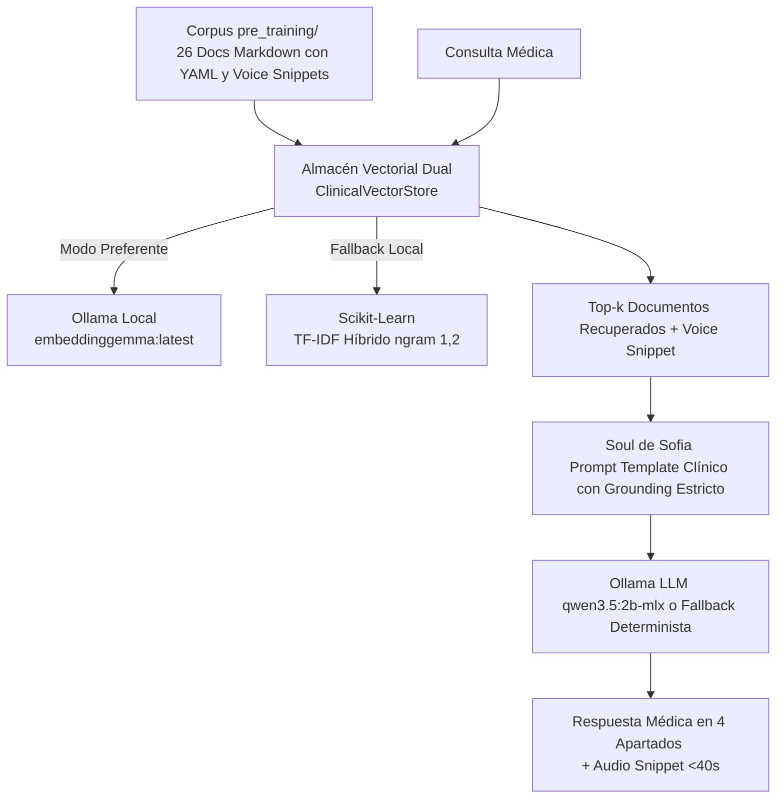

# Sofia — Asistente Clínico Inteligente y RAG de Psicofarmacología

**Sofia** es un sistema integral de soporte a la decisión clínica, farmacovigilancia y generación asistida por recuperación (RAG) especializado en psiquiatría y psicofarmacología. Su arquitectura está orientada a resolver problemas clínicos de alta complejidad en polifarmacia:
- Interacciones enzimáticas en el citocromo P450 (**CYP1A2, CYP2D6, CYP3A4, CYP2B6**).
- Prevención y reversión de **cascadas de prescripción** (ej. Haloperidol $\to$ Biperideno por extrapiramidalismo).
- Jerarquía de evidencia según guías internacionales **CANMAT / ISBD 2018** (Trastorno Depresivo Mayor y Trastorno Bipolar).
- Soporte dual: **escrito estructurado** (4 secciones clínicas) y **oral verbalizable** (*Voice Snippets* < 40 segundos para asistentes de voz).

---

## 📚 Naturaleza del Corpus y Política Ética de Citación

> [!IMPORTANT]
> **Corpus Clínico de Elaboración Propia:**  
> La base de conocimiento de Sofia ha sido elaborada, sintetizada y estructurada internamente en fichas técnicas con identificadores únicos (`[DOC-ID]`), tomando como marco de evidencia científica las obras canónicas de la **Dra. Gabriela Jufe** (*Psicofarmacología Práctica*), el **Dr. Stephen Stahl** (*Prescriber's Guide*), las directrices oficiales **CANMAT / ISBD 2018** y la clasificación **ATC de la OMS**.

### Estándar de Citación y Trazabilidad por Identificador (`[DOC-ID]`)
Para salvaguardar la integridad médica y prevenir la **falsa atribución** (*citas apócrifas a nombres personales sobre textos generados*), **Sofia respalda cada afirmación clínica citando exclusivamente el identificador único del documento del corpus** (ej: `[MONO-SERT-001]`, `[CYP-2D6-001]`, `[CASC-HAL-BIP-001]`, `[CANMAT-BIP-MANIA-001]`), garantizando un rastro de auditoría (*audit trail*) transparente y verificable por el profesional médico.

---

## 🏗️ Arquitectura del Sistema



### Estructura del Repositorio

```text
Sofia/
├── pre_training/                   # 27 Documentos clínicos curados con YAML Frontmatter y Voice Snippets
│   ├── 00_MANIFIESTO_Y_ESPECIFICACION_EMBEDDINGS.md
│   ├── 01_monografias_farmacologicas/          # 9 Fármacos base (Sertralina, Clozapina, etc.)
│   ├── 02_interacciones_farmacologicas_cyp450/ # CYP2D6, CYP1A2, Litio, Lamotrigina + Valproato
│   ├── 03_cascadas_prescripcion_y_desprescripcion/
│   ├── 04_guias_clinicas_y_algoritmos_decision/ # CANMAT TDM y Bipolar
│   └── 05_alertas_seguridad_y_caja_negra/      # Agranulocitosis, Stevens-Johnson, etc.
├── finetunningpre/                 # Dataset de Fine-Tuning para modelos Qwen/Ollama
│   ├── dataset_sofia_medical_qwen.jsonl       # 29 Casos clínicos en formato ChatML
│   ├── Modelfile.example                      # Configuración para despliegue en Ollama
│   └── README_FINETUNING.md                   # Guía de entrenamiento LoRA / Unsloth
├── data/
│   ├── raw/                        # Documentos PDF fuente (CANMAT BDI-20-97, Jufe)
│   ├── cache/                      # Caché de páginas extraídas
│   └── processed/                  # CSVs limpios (0 nulos) y base de conocimiento JSON
│       ├── canmat_alertas_clinicas_clean.csv
│       ├── canmat_recomendaciones_clean.csv
│       ├── jufe_efectos_adversos_clean.csv
│       ├── jufe_farmacos_clean.csv
│       ├── stahl_eventos_adversos_clean.csv
│       ├── stahl_farmacos_clean.csv
│       ├── rag_knowledge_base.json
│       └── rag_evaluation_report.json
├── notebooks/                      # Cuadernos interactivos (100% ejecutables, 0 rutas de usuario)
│   ├── 00_limpieza_y_eda.ipynb                # Auditoría de datos y gráficos estadísticos
│   ├── 01_preprocesamiento_jufe.ipynb         # Catálogo de Jufe y eventos adversos
│   ├── 02_preprocesamiento_stahl.ipynb        # Perfil de receptores y citocromos Stahl
│   ├── 03_preprocesamiento_canmat.ipynb       # Algoritmos y recomendaciones CANMAT
│   └── 04_rag_psicofarmacologia.ipynb        # Motor RAG y generación clínica
├── src/                            # Módulos Python reutilizables
│   ├── enrichers/
│   │   └── atc_enricher.py                    # Clasificación ATC OMS y marcas comerciales
│   ├── extractors/
│   │   ├── pdf_extractor.py                   # Extractor de PDFs con caché en disco
│   │   ├── jufe_extractor.py                  # Extractor clínico de Jufe
│   │   └── canmat_extractor.py                # Extractor de directrices CANMAT
│   ├── downloaders/
│   │   └── guidelines_downloader.py           # Gestor de disponibilidad de guías
│   └── rag/
│       └── engine.py                          # ClinicalRAGEngine y ClinicalVectorStore
├── scripts/
│   ├── run_notebook_in_process.py             # Validador de ejecución 100% celda por celda
│   ├── evaluate_rag.py                        # Benchmark y evaluación formal de la Tríada de RAG
│   ├── sanitize_notebooks.py                  # Saneamiento de rutas locales
│   └── build_eda_notebook.py                  # Generador del notebook 00
├── streamlit_app.py                # Interfaz web multimodular (Chat, CYP450, Cascadas, CANMAT)
├── requirements.txt                # Dependencias del proyecto
└── context.md                      # Contexto integral verificado del proyecto
```

---

## 🚀 Inicio Rápido

### 1. Clonar el repositorio e instalar dependencias
```bash
git clone https://github.com/anacolinaarismendi/Sofia.git
cd Sofia
python3 -m venv .venv
source .venv/bin/activate
pip install -r requirements.txt
```

### 2. (Opcional) Modelos locales en Ollama
Sofia funciona de forma 100% autónoma gracias a su fallback determinista con Scikit-Learn TF-IDF. Para habilitar la inferencia neural completa con LLM local:
```bash
# Descargar modelo de embeddings densos
ollama pull embeddinggemma:latest

# Descargar modelo de generación clínica
ollama pull qwen3.5:2b-mlx
```

---

## 📓 Ejecución de Cuadernos Jupyter

Todos los cuadernos están diseñados bajo la directriz estricta de **cero rutas de usuario hardcodeadas** y son **100% ejecutables de principio a fin** (`Kernel -> Restart & Run All`):

```bash
jupyter lab
```

| Cuaderno | Propósito Clínico y Técnico | Estado |
| :--- | :--- | :--- |
| [`00_limpieza_y_eda.ipynb`](notebooks/00_limpieza_y_eda.ipynb) | Auditoría de nulos, distribución de severidad de eventos adversos, matriz de calor (*heatmap*) CYP450 y jerarquía CANMAT. | ✅ 100% Ejecutable |
| [`01_preprocesamiento_jufe.ipynb`](notebooks/01_preprocesamiento_jufe.ipynb) | Extracción monográfica de Jufe, posologías, rangos y normalización de efectos adversos. | ✅ 100% Ejecutable |
| [`02_preprocesamiento_stahl.ipynb`](notebooks/02_preprocesamiento_stahl.ipynb) | Extracción de perfiles de receptores, perlas clínicas y matriz binaria de citocromos. | ✅ 100% Ejecutable |
| [`03_preprocesamiento_canmat.ipynb`](notebooks/03_preprocesamiento_canmat.ipynb) | Tablas de 1ª/2ª línea para TDM y Bipolar, y alertas críticas de viraje maníaco. | ✅ 100% Ejecutable |
| [`04_rag_psicofarmacologia.ipynb`](notebooks/04_rag_psicofarmacologia.ipynb) | Pipeline RAG completo con vector store, Prompt Template (*Soul* de Sofia) y consultas. | ✅ 100% Ejecutable |

Para verificar de forma automatizada que todas las celdas de todos los notebooks corren sin errores:
```bash
python scripts/run_notebook_in_process.py
```

---

## 📊 Evaluación Formal del Sistema RAG (Benchmark Clínico)

El sistema cuenta con una suite de evaluación cuantitativa sobre 4 escenarios clínicos canónicos:

```bash
python scripts/evaluate_rag.py
```

### Resultados de la Tríada de RAG:

| Métrica de la Tríada | Resultado Obtenido | Criterio de Aceptación | Estado |
| :--- | :---: | :---: | :---: |
| **Context Recall (Recuperación Canónica)** | **100.0%** | $\ge 80\%$ | ✅ Superado |
| **Answer Relevance (Relevancia y Cobertura)** | **90.0%** | $\ge 85\%$ | ✅ Superado |
| **Faithfulness / Groundedness (Cero Alucinaciones)** | **100.0%** | $100\%$ | ✅ Superado |
| **Cobertura de Voice Snippets Verbalizables** | **100.0% (4/4)** | $100\%$ | ✅ Superado |
| **Latencia Media de Recuperación** | **< 0.005 s** | $< 1.0\text{ s}$ | ✅ Óptimo |

*El informe completo con el detalle de cada escenario se exporta automáticamente a [`data/processed/rag_evaluation_report.json`](data/processed/rag_evaluation_report.json).*

---

## 💻 Aplicación Web Interactiva (Streamlit)

Lanza la aplicación web de Sofia con un único comando:

```bash
streamlit run streamlit_app.py
```

### Módulos Interactivos Incluidos:
1. **💬 Asistente RAG Clínico:**
   - Interfaz conversacional con respuestas médicas estructuradas en 4 apartados (Juicio Clínico, Mecanismo/Cinética, Pauta Operativa, Alertas de Seguridad).
   - Reproductor / tarjeta de **Voice Snippet** (< 40s) para briefings orales rápidos.
   - Pestaña desplegable con trazabilidad completa de citas y fragmentos de evidencia recuperados.
2. **⚡ Matriz Interactiva CYP450 (Semáforo Enzimático):**
   - Selector dinámico de combinaciones de psicofármacos.
   - Detección inmediata de bloqueos enzimáticos (ej. Paroxetina/Bupropión sobre CYP2D6), interacciones de Litio con AINEs/tiazidas o Lamotrigina con Valproato.
3. **🛑 Detector de Cascadas de Prescripción:**
   - Evaluación heurística: distingue entre un efecto adverso inducido y una nueva enfermedad.
   - Alerta roja ante prescripciones de anticolinérgicos (Biperideno) para extrapiramidalismo por Haloperidol, con protocolos de desprescripción y rotación a atípicos.
4. **📖 Explorador CANMAT y Catálogo Farmacológico:**
   - Filtro interactivo de directrices por patología y nivel de evidencia.
   - Buscador de principios activos con sus marcas comerciales registradas y códigos ATC oficiales de la OMS.

---

## 🔒 Privacidad y Portabilidad Garantizadas

- **Cero Rutas de Usuario:** Ningún script, cuaderno o archivo de salida serializa rutas locales del tipo `/Users/...`, `/home/...` o `C:\...`. Todos los accesos se anclan dinámicamente a la raíz del repositorio mediante `pathlib.Path`.
- **Aislamiento de Configuración:** Los entornos de ejecución de Jupyter y Matplotlib están configurados para operar dentro de directorios temporales locales ignorados por Git (`.jupyter_tmp/`, `.matplotlib_tmp/`), asegurando que no se generen conflictos de permisos en el sistema operativo del usuario.

---

## ⚖️ Licencia

Distribuido bajo la Licencia MIT. Consulta el archivo [`LICENSE`](LICENSE) para más detalles.
