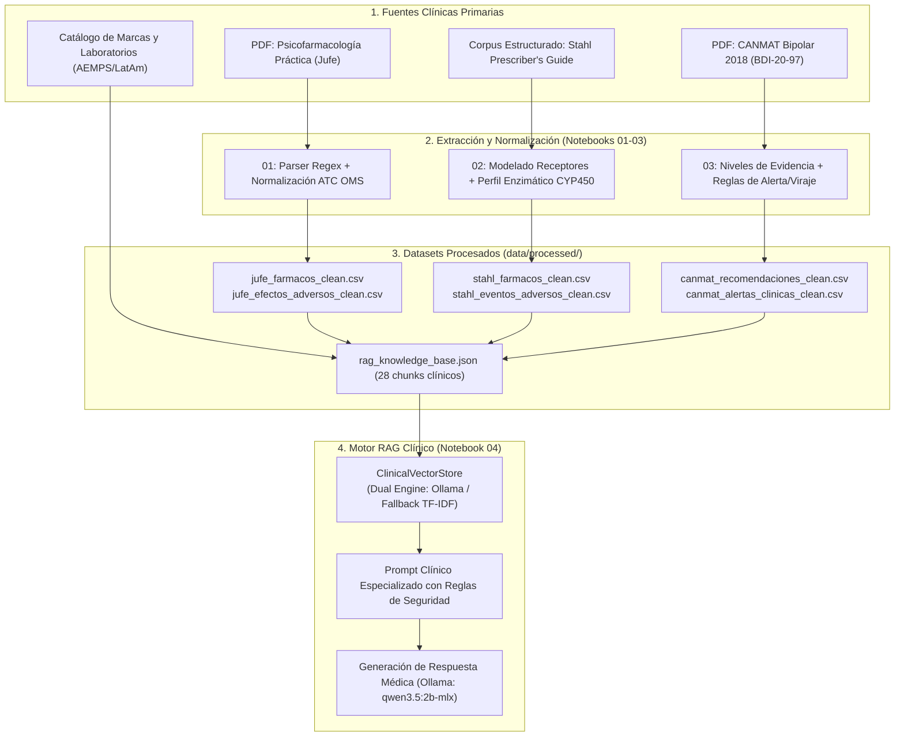

# Contexto Técnico y Clínico del Proyecto Sofia

Este documento proporciona el contexto integral, verificado y exhaustivo del proyecto **Sofia**. Está diseñado para que cualquier sistema de Inteligencia Artificial, desarrollador o investigador biomédico comprenda inmediatamente la arquitectura, el dominio clínico, las fuentes de conocimiento, el pipeline de datos, los modelos de lenguaje/embeddings y las pautas de evolución técnica sin ambigüedades.

---

## 1. Identificación y Propósito General

- **Nombre del Proyecto:** Sofia
- **Definición:** Asistente Clínico Inteligente y Motor RAG (Retrieval-Augmented Generation) especializado en Farmacovigilancia, Soporte a la Decisión Psiquiátrica y Psicofarmacología Basada en Evidencia.
- **Problema que Resuelve:**
  - **Polifarmacia Psiquiátrica Compleja:** En salud mental es frecuente la prescripción simultánea de múltiples psicotrópicos (antipsicóticos, antidepresivos, estabilizadores del ánimo, ansiolíticos). Sofia analiza compatibilidades, rangos posológicos y riesgos acumulativos.
  - **Interacciones Farmacocinéticas Enzimáticas (CYP450):** Detecta inhibiciones, inducciones y competición por sustratos en los citocromos hepáticos clave (CYP1A2, CYP2D6, CYP3A4, CYP2B6, etc.), evitando elevaciones tóxicas o fallos terapéuticos.
  - **Prevención de Cascadas de Prescripción:** Identifica cuando un fármaco secundario se prescribe para tratar un efecto adverso no reconocido de un fármaco primario (ejemplo clásico: Haloperidol que induce síntomas extrapiramidales/parkinsonismo, respondiendo con Biperideno/anticolinérgicos en lugar de ajustar la dosis o cambiar a un antipsicótico atípico).
  - **Alertas de Seguridad Crítica:** Identifica riesgos de **viraje maníaco** (ej. antidepresivos en monoterapia en Trastorno Bipolar), monitorización de rangos estrechos (litemia plasmática en Carbonato de Litio), monitorización hematológica estricta (agranulocitosis por Clozapina), interacciones sinérgicas peligrosas (Lamotrigina + Ácido Valproico y Síndrome de Stevens-Johnson) y teratogenicidad.
  - **Estandarización y Trazabilidad Comercial:** Mapea principios activos a códigos ATC oficiales de la OMS y vincula nombres comerciales y laboratorios de referencia (España, Latinoamérica e internacional).
- **Usuarios Objetivo:** Médicos psiquiatras, neurólogos, médicos residentes (MIR), farmacólogos clínicos y desarrolladores de sistemas de apoyo al diagnóstico clínico (CDSS).

---

## 2. Fuentes Clínicas Primarias y Oficiales

El sistema se sustenta exclusivamente en fuentes médicas y regulatorias autorizadas:

1. **Dra. Gabriela Jufe — *Psicofarmacología Práctica*:**
   - **Formato / Ubicación:** Archivo PDF oficial en `data/raw/Psicofarmacologia practica - G. Jufe.pdf` (7.1 MB).
   - **Aporte al Sistema:** Monografías detalladas de principios activos, clasificación psicofarmacológica, rangos terapéuticos, pautas de inicio y titulación, eventos adversos e interacciones directas, con énfasis en poblaciones especiales (embarazo, lactancia, insuficiencia renal/hepática, adultos mayores).
2. **Dr. Stephen Stahl — *The Prescriber's Guide* (Stahl's Essential Psychopharmacology):**
   - **Aporte al Sistema:** Perfil molecular y afinidad por receptores neurotransmisores (5-HT2A, 5-HT2C, D2, D4, H1 histaminérgico, M1 muscarínico, alfa-1 adrenérgico, transportadores SERT, DAT, NET). Desglose exhaustivo de vías de metabolización hepática por citocromos CYP450 (sustrato principal/secundario, inhibidor potente/moderado, inductor). Clasificación de efectos adversos según gravedad (comunes vs potencialmente letales) y "perlas clínicas" (*clinical pearls*) para la práctica diaria.
3. **Guías Clínicas CANMAT e ISBD (2018 / 2016):**
   - **CANMAT / ISBD 2018:** *Guidelines for the Management of Patients with Bipolar Disorder* (`data/raw/BDI-20-97.pdf`, 3.4 MB).
   - **CANMAT 2016:** *Clinical Guidelines for the Management of Adults with Major Depressive Disorder (MDD)*.
   - **Aporte al Sistema:** Algoritmos jerárquicos basados en evidencia para fases agudas, de mantenimiento y resistentes. Clasificación estandarizada en Líneas de Tratamiento (Primera Línea, Segunda Línea, Tercera Línea, No Recomendado / Contraindicado), Estrategias (Monoterapia, Combinación, Potenciación / Add-on) y Niveles de Evidencia (Level 1 a Level 4). Alertas formales de contraindicación (ej. viraje a manía).
4. **Bases de Datos Médicas y Regulatorias Complementarias:**
   - **Clasificación ATC de la OMS:** Normalización jerárquica (Nivel 1 Sistema Nervioso, Nivel 2 Psicolépticos/Psicoanalépticos, Nivel 3 Grupos terapéuticos, Nivel 5 Principio Activo).
   - **CIMA (AEMPS):** Marcas comerciales oficiales, presentaciones y formatos en España.
   - **OpenFDA:** Fichas técnicas, prospectos y advertencias de caja negra (*Boxed Warnings*).
   - **RxNav / NLM (NIH):** Identificadores normalizados RxCUI y verificación determinista de interacciones.

---

## 3. Estructura del Repositorio y Estado Actual

```
Sofia/
├── context.md                    # Este documento: especificación y contexto técnico unificado
├── README.md                     # Descripción del proyecto y arquitectura proyectada
├── requirements.txt              # Especificación de librerías y versiones de Python
├── LICENSE                       # Licencia MIT (2026, anacolinaarismendi)
├── data/
│   ├── raw/                      # Documentación clínica en formato PDF original
│   │   ├── BDI-20-97.pdf         # Guía oficial CANMAT/ISBD 2018 para Trastorno Bipolar (3.4 MB)
│   │   └── Psicofarmacologia practica - G. Jufe.pdf  # Manual clínico de Dra. Jufe (7.1 MB)
│   ├── processed/                # Datasets limpios generados por los pipelines de extracción
│   │   ├── jufe_farmacos_clean.csv          # Catálogo monográfico de Jufe enriquecido con ATC
│   │   ├── jufe_efectos_adversos_clean.csv  # Relación normalizada fármaco-efecto adverso (Jufe)
│   │   ├── stahl_farmacos_clean.csv         # Monografías de Stahl con receptores, perlas y CYP
│   │   ├── stahl_eventos_adversos_clean.csv # Eventos adversos de Stahl (comunes vs graves)
│   │   ├── canmat_recomendaciones_clean.csv # Recomendaciones jerárquicas CANMAT (TDM y Bipolar)
│   │   ├── canmat_alertas_clinicas_clean.csv# Reglas de contraindicación y riesgo de viraje
│   │   └── rag_knowledge_base.json          # 28 chunks estructurados listos para vectorización
│   └── cache/                    # Almacén de caché en disco (páginas extraídas y llamadas API)
├── notebooks/                    # Pipeline interactivo de análisis, extracción y RAG
│   ├── 01_preprocesamiento_jufe.ipynb    # Ingesta, parseo heurístico y enriquecimiento ATC de Jufe
│   ├── 02_preprocesamiento_stahl.ipynb   # Modelado de CYP450, severidad y perlas de Stahl
│   ├── 03_preprocesamiento_canmat.ipynb  # Algoritmos CANMAT, evidencia y reglas de viraje
│   └── 04_rag_psicofarmacologia.ipynb    # Motor RAG multifuente, vector store y evaluación LLM
└── [ana/ | .venv/]               # Entornos virtuales locales (excluidos en .gitignore)
```

> [!NOTE]
> **Estado de Modularización (Notebooks vs. Paquetería `src/`):**  
> El sistema se encuentra actualmente implementado y validado de extremo a extremo dentro de la suite de notebooks (`01` a `04`).  
> El `README.md` describe la arquitectura modular proyectada en paquetes (`src/extractors`, `src/downloaders`, `src/enrichers`, `scripts/download_and_extract.py`, `tests/`), hacia la cual se migrará progresivamente la lógica contenida en los notebooks. Al interactuar con el código, las IAs deben entender que los algoritmos ejecutables de referencia residen en los notebooks y en los datasets procesados de `data/processed/`.

---

## 4. Stack Tecnológico y Dependencias

- **Lenguaje Base:** Python 3.12 (`Python 3.12 (Sofia)` en kernel de Jupyter).
- **Procesamiento de Datos y Álgebra:**
  - `pandas>=2.0.0` (DataFrames y normalización tabular)
  - `numpy>=1.24.0` (Cálculo de matrices de embeddings y métricas vectoriales)
  - `scikit-learn>=1.3.0` (`TfidfVectorizer` y `cosine_similarity` para el motor vectorial de contingencia)
  - `openpyxl>=3.1.0` (Exportación/ingesta de hojas clínicas)
- **Extracción de Documentos Médicos:**
  - `pdfplumber>=0.10.0` (Extracción de texto estructurado y tablas en PDFs clínicos)
  - `pypdf>=3.17.0` / `pdfminer.six` (Lectura y segmentación de páginas)
- **Motor RAG e Inferencia Local (Ollama):**
  - `requests>=2.31.0` (Comunicación HTTP REST con la API de Ollama)
  - **Servidor Ollama:** `http://localhost:11434`
  - **Modelo de Embeddings:** `embeddinggemma:latest` (o modelo local equivalente)
  - **Modelo LLM de Generación:** `qwen3.5:2b-mlx` (o modelos locales como Llama 3 / Mistral)
- **Persistencia y Calidad:**
  - `SQLAlchemy>=2.0.0` (Persistencia en SQLite para frontend en Streamlit)
  - `pytest>=7.0.0` (Testing automatizado y aserciones de consistencia en notebooks)

---

## 5. Arquitectura del Motor RAG y Pipeline de Datos



### Detalle del `ClinicalVectorStore` (Diseño Resiliente Dual)
1. **Detección Automática de Ollama:**  
   Al instanciarse, realiza un `GET http://localhost:11434/api/tags` (timeout 1.5 s). Si responde, activa el modo semántico neural usando `embeddinggemma:latest`.
2. **Fallback Autónomo Local:**  
   Si Ollama no está en ejecución, conmuta automáticamente a Scikit-Learn:
   - Vectorizador: `TfidfVectorizer(ngram_range=(1, 2), max_features=1000)`
   - Métrica de similitud: Similitud del coseno (`cosine_similarity`)
   - Resultado: El sistema **nunca se bloquea ni genera excepciones** en entornos sin GPU o sin servidor Ollama activo.
3. **Estructura de Fichas Clínicas (Document Chunks):**
   - **Tipo `farmaco_monografia` (9 principios activos):** Ficha integrada con datos de Jufe (mecanismo, posología, poblaciones especiales), Stahl (perfil de receptores, enzimas CYP, efectos comunes vs graves, perlas) y catálogo de marcas y laboratorios (Zoloft, Serlift, Haldol, Risperdal, Clozaril, Wellbutrin, Lamictal, etc.).
   - **Tipo `guia_canmat` (19 directrices):** Recomendaciones categorizadas por patología (TDM, Bipolar), fase (Aguda, Mantenimiento, Resistencia), línea terapéutica, fármaco y nivel de evidencia científica.

---

## 6. Modelo de Datos y Entidades Clínicas

### A. Catálogo de Fármacos de Jufe (`jufe_farmacos_clean.csv`)
- `farmaco`: Nombre genérico o DCI (ej. `Sertralina`, `Fluoxetina`, `Risperidona`, `Haloperidol`, `Litio`).
- `clase`: Familia farmacológica (ej. `ISRS`, `Antipsicótico Atípico`, `Antipsicótico Típico`).
- `mecanismo`: Descripción del mecanismo neuroquímico de acción.
- `posologia`: Rango terapéutico en mg/día y pautas de ajuste o monitorización.
- `efectos_adversos`: Resumen textual de reacciones adversas.
- `interacciones`: Interacciones clínicas principales y fármacos contraindicados.
- `poblaciones_especiales`: Ajustes en embarazo, pediatría, geriatría o fallo renal/hepático.
- `atc_codigo`: Código de 7 caracteres de la OMS (ej. `N06AB06`).
- `atc_grupo`: Subgrupo terapéutico ATC (ej. `Antidepresivos`, `Antipsicóticos`).

### B. Eventos Adversos Desagregados (`jufe_efectos_adversos_clean.csv` y `stahl_eventos_adversos_clean.csv`)
- `farmaco`: Principio activo vinculado.
- `atc_codigo`: Código ATC para cruces deterministas.
- `efecto_adverso`: Nombre clínico del síntoma/signo (ej. `Agranulocitosis`, `Temblor fino`, `Aumento de peso`, `Náuseas`, `Disfunción sexual`).
- `severidad`: Clasificación clínica: `Común / Moderado` vs `Grave / Potencialmente Mortal`.
- `fuente_evidencia`: Manual de origen (`Jufe - Psicofarmacología Práctica` o `Stahl - Prescriber's Guide`).

### C. Farmacocinética y Citocromos CYP450 (`stahl_farmacos_clean.csv`)
- `farmaco`, `clase`, `perfil_receptores`, `metabolismo_cyp`, `efectos_comunes`, `efectos_graves`, `perlas_clinicas`.
- Columnas binarias booleanas / de clasificación de citocromos:
  - `inhibidor_cyp2d6`: Si inhibe potentemente el citocromo 2D6 (ej. `Paroxetina = True`, `Bupropión = True`).
  - `sustrato_cyp1a2`: Metabolismo dependiente de 1A2 (ej. `Clozapina = True`, afectada por el tabaco).
  - `sustrato_cyp2d6`: Sustrato de 2D6.
  - `sustrato_cyp3a4`: Sustrato de 3A4.

### D. Directrices y Alertas CANMAT (`canmat_recomendaciones_clean.csv` y `canmat_alertas_clinicas_clean.csv`)
- `patologia`: `Trastorno Depresivo Mayor (TDM)` o `Trastorno Bipolar`.
- `fase`: `Aguda`, `Manía Aguda`, `Depresión Bipolar`, `Mantenimiento`, `Resistencia / Potenciación`.
- `linea`: `Primera Línea`, `Segunda Línea`, `Tercera Línea`, `No Recomendado / Contraindicado`.
- `estrategia`: `Monoterapia`, `Combinación`, `Potenciación (Add-on)`.
- `farmaco`: Principio activo o esquema sugerido (ej. `Litio + Antipsicótico Atípico`).
- `nivel_evidencia`: `Level 1` (metaanálisis/ensayos controlados doble ciego), `Level 2`, etc.
- `tipo_alerta`: `Contraindicación / Riesgo de Viraje`.
- `descripcion`: Justificación clínica del daño o desestabilización.

---

## 7. Protocolos de Seguridad y Farmacovigilancia de Sofia

El sistema incorpora reglas clínicas deterministas y heurísticas de seguridad:

1. **Prevención de Viraje a Manía:**
   - **Regla:** En depresión bipolar (Trastorno Bipolar I y II), los antidepresivos (ISRS, tricíclicos, duales) en monoterapia están estrictamente desaconsejados o contraindicados (Evidencia CANMAT Level 1 de Daño).
   - **Conducta esperada:** Alertar inmediatamente del riesgo de inducción de episodios maníacos agudos o ciclos rápidos.
2. **Detección de Cascadas de Prescripción:**
   - **Regla:** Síntoma nuevo tras iniciar o titular un psicofármaco = Efecto adverso hasta que se demuestre lo contrario.
   - **Ejemplo de referencia (Caso 4 validado en Notebook 04):**
     - *Fármaco 1:* Haloperidol (antipsicótico típico con potente bloqueo D2 nigroestriatal).
     - *Efecto adverso:* Parkinsonismo secundario farmacológico (rigidez, temblor, acinesia).
     - *Cascada de prescripción:* Prescribir Biperideno o Trihexifenidilo (anticolinérgicos).
     - *Riesgo asociado:* Carga anticolinérgica, deterioro cognitivo, constipación grave, visión borrosa, riesgo de dependencia y precipitación de **discinesia tardía**.
     - *Recomendación del sistema:* Reducir dosis de Haloperidol o rotar a antipsicótico atípico con baja afinidad D2 (ej. Quetiapina o Clozapina).
3. **Interacciones Enzimáticas CYP450 Críticas:**
   - **Regla:** La coadministración de un potente inhibidor de CYP2D6 (Paroxetina, Fluoxetina, Bupropión) con sustratos de índice estrecho metabolizados por esta enzima multiplica la concentración plasmática del sustrato.
   - **Regla del tabaco (CYP1A2):** Los hidrocarburos del humo del tabaco inducen potentemente el CYP1A2. Al dejar de fumar o fumar menos, los niveles de Clozapina aumentan súbitamente, pudiendo provocar intoxicación y convulsiones.
4. **Reglas de Monitorización Obligatoria:**
   - **Litio:** Rango terapéutico plasmático estrecho (0.6 a 1.0 mEq/L en mantenimiento; hasta 1.2 mEq/L en manía). Los AINEs (ibuprofeno, naproxeno), diuréticos tiazídicos e IECA reducen la excreción renal de litio provocando toxicidad grave. Exige función renal y tiroidea cada 6 meses.
   - **Clozapina:** Riesgo de agranulocitosis (neutropenia grave). Exige hemogramas periódicos obligatorios.
   - **Lamotrigina + Valproato:** El ácido valproico inhibe la glucuronidación de la lamotrigina, duplicando su vida media y aumentando drásticamente el riesgo de Síndrome de Stevens-Johnson / Necrólisis Epidérmica Tóxica. Requiere reducir la dosis de inicio de lamotrigina a más del 50%.

---

## 8. Casos Clínicos de Validación (Benchmarks Implementados)

En `notebooks/04_rag_psicofarmacologia.ipynb` se evalúan con éxito cuatro escenarios clínicos tipo:

| Caso | Consulta Médica | Fuente Evaluada | Conceptos Clave Validados |
| :--- | :--- | :--- | :--- |
| **1** | Laboratorios, marcas comerciales y posología de Sertralina | Jufe + Catálogo de Marcas | Pfizer (Zoloft), Roemmers (Serlift), Almirall (Aremis). Rango 25-50 mg/día hasta 200 mg/día. |
| **2** | Interacciones y precauciones CYP2D6 con Paroxetina y Bupropión | Stahl Prescriber's Guide | Potentes inhibidores de CYP2D6. Riesgo de toxicidad al combinarse con sustratos de 2D6. |
| **3** | CANMAT primera línea para manía aguda y viraje en depresión bipolar | Guías CANMAT / ISBD | 1ª Línea Manía: Litio, Valproato, Quetiapina o combinación. Contraindicación: ISRS en monoterapia en depresión bipolar (Riesgo de viraje). |
| **4** | Detección de cascada de prescripción: Haloperidol y Biperideno | Jufe + Stahl | Diagnóstico de efecto extrapiramidal por bloqueo D2. Advertencia contra la cascada con Biperideno por carga anticolinérgica y discinesia tardía. |

---

## 9. Instrucciones Operativas para Desarrolladores e IAs

Al trabajar en este repositorio, cualquier agente de IA o desarrollador debe acatar las siguientes directrices:

1. **Principio de Integridad Médica:**
   - Nunca inventar dosis, interacciones, frecuencias ni advertencias clínicas.
   - Toda afirmación clínica debe estar respaldada y citar explícitamente su fuente (`Según Jufe...`, `De acuerdo con Stahl...`, `La guía CANMAT 2018 indica...`).
2. **Prioridad de Ejecución y Pruebas:**
   - La suite de notebooks en `notebooks/` es reproducible y autosuficiente. Cada notebook cuenta con aserciones automáticas (`assert`) que verifican la integridad de los datos.
   - Si se modularizan componentes hacia `src/`, se deben mantener las interfaces y no alterar los esquemas de los CSVs en `data/processed/` sin actualizar el constructor de `documentos_rag` en `04_rag_psicofarmacologia.ipynb`.
3. **Manejo de Dependencias y Modelos:**
   - Respetar `requirements.txt`.
   - Considerar siempre que el entorno del usuario puede tener o no Ollama activo. Cualquier código nuevo para el RAG debe mantener el patrón de diseño resiliente (usar Ollama si está disponible, con fallback local determinista en `scikit-learn`).
4. **Seguridad y Confidencialidad:**
   - Nunca almacenar claves de API, datos sensibles de pacientes ni registros identificables. El proyecto se basa exclusivamente en datos biomédicos públicos y directrices publicadas.
5. **Git y Estructura:**
   - Los directorios de datos binarios grandes y cachés (`data/cache/`, `data/raw/` si superan límites) deben mantenerse gestionados adecuadamente en `.gitignore`.
