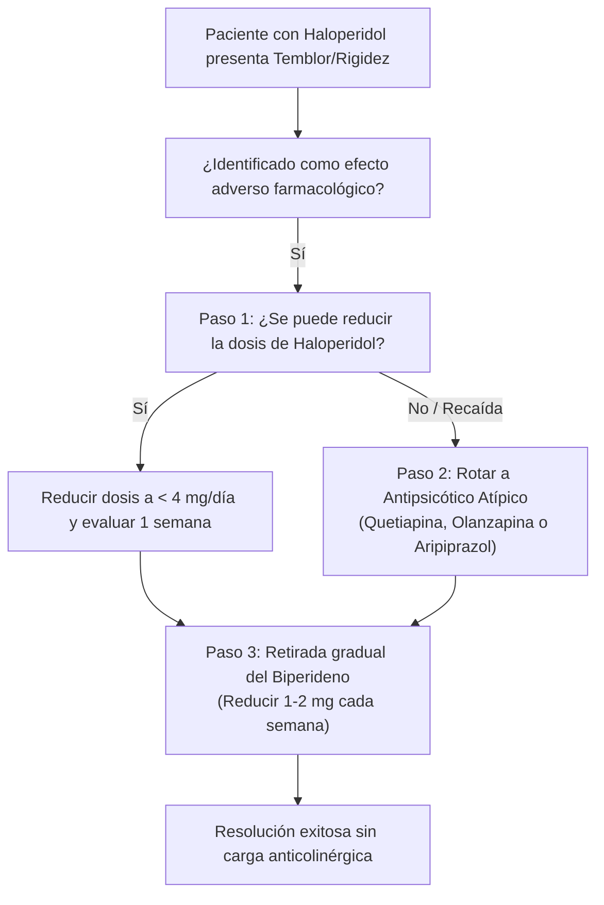

# Cascada de Prescripción: Haloperidol inducido y Biperideno

## 1. Resumen Ejecutivo Verbalizable (Voice Snippet)
> "Una cascada de prescripción ocurre cuando el efecto adverso de un primer fármaco es diagnosticado erróneamente como una nueva enfermedad, recetándose un segundo medicamento para tratarlo. El ejemplo clásico en psiquiatría es el uso de haloperidol: debido a su potente bloqueo de dopamina, produce rigidez, temblor y lentitud motora en rueda dentada. En lugar de disminuir la dosis o cambiar a un antipsicótico atípico, con frecuencia se receta biperideno. Esta cascada encubre el problema y expone al paciente a una peligrosa carga anticolinérgica con pérdidas de memoria, confusión, estreñimiento severo, retención urinaria y un mayor riesgo de desarrollar discinesia tardía irreversible. La desprescripción razonada exige reducir el haloperidol y retirar progresivamente el anticolinérgico."

## 2. Anatomía de la Cascada Clínica
1. **Fármaco Inicial:** Haloperidol (Antipsicótico típico de alta potencia).
2. **Efecto Adverso Generado:** Parkinsonismo secundario farmacológico (bloqueo > 80% de receptores D2 en la vía dopaminérgica nigroestriatal).
3. **Interpretación Errónea / Conducta Reactiva:** Se asume que el temblor o la rigidez requieren farmacoterapia obligatoria, prescribiendo **Biperideno** (Akineton) o Trihexifenidilo.
4. **Daño Iatrogénico Acumulativo:**
   - *Carga Anticolinérgica:* Deterioro neurocognitivo, fallos ejecutivos y de memoria episódica, sedación, midriasis con riesgo de glaucoma de ángulo cerrado, retención aguda de orina e íleo paralítico.
   - *Riesgo Psiquiátrico:* El biperideno genera potencial de abuso, euforia y descompensaciones psicóticas con alucinaciones tóxicas en adultos mayores.
   - *Empeoramiento Motor Tardío:* Los anticolinérgicos aumentan la sensibilidad de los receptores D2 estriatales desnervados, acelerando la aparición de **discinesia tardía**.

## 3. Algoritmo de Desprescripción y Resolución

## 4. Guía de Interrogatorio Clínico Verbal
- "Doctor, el temblor y la lentitud que presenta este paciente comenzaron dos semanas después de subir el haloperidol. Antes de añadir biperideno, ¿hemos considerado reducir la dosis o rotar a quetiapina para proteger su rendimiento cognitivo y evitar una discinesia tardía?"
