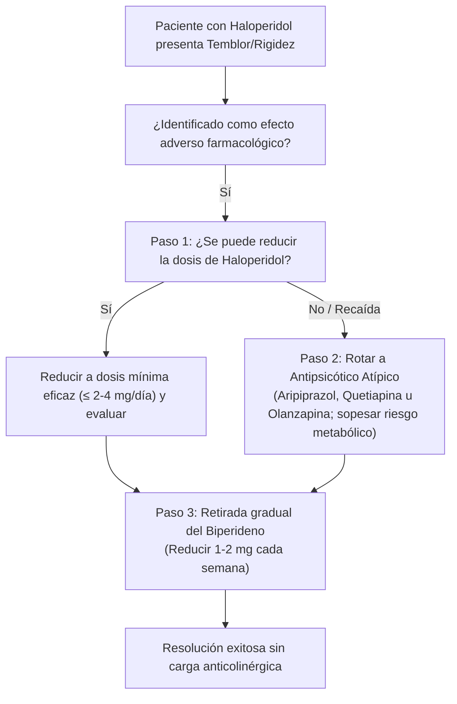

# Cascada de Prescripción: Haloperidol inducido y Biperideno

## 1. Resumen Ejecutivo Verbalizable (Voice Snippet)
> "Una cascada de prescripción ocurre cuando un efecto adverso es tratado erróneamente con un segundo fármaco en lugar de ajustar el causante. El ejemplo paradigmático es el haloperidol: su potente bloqueo dopaminérgico causa rigidez y parkinsonismo secundario. Prescribir biperideno de forma crónica añade una peligrosa carga anticolinérgica con deterioro cognitivo, constipación grave y riesgo de empeorar o desenmascarar discinesia tardía. El protocolo de desprescripción razonada de Sofia orienta a reducir a la dosis mínima eficaz de haloperidol o rotar a un antipsicótico atípico con bajo perfil motor, desescalando y retirando el biperideno gradualmente en dos a cuatro semanas."

## 2. Anatomía de la Cascada Clínica
1. **Fármaco Inicial:** Haloperidol (Antipsicótico típico de alta potencia).
2. **Efecto Adverso Generado:** Parkinsonismo secundario farmacológico (bloqueo > 80% de receptores D2 en la vía dopaminérgica nigroestriatal).
3. **Interpretación Errónea / Conducta Reactiva:** Se asume que el temblor o la rigidez requieren farmacoterapia obligatoria crónica, prescribiendo **Biperideno** (Akineton) o Trihexifenidilo.
4. **Daño Iatrogénico Acumulativo:**
   - *Carga Anticolinérgica:* Deterioro neurocognitivo, fallos ejecutivos y de memoria episódica, sedación, midriasis con riesgo de glaucoma de ángulo cerrado, retención aguda de orina e íleo paralítico.
   - *Riesgo Psiquiátrico:* El biperideno genera potencial de abuso, euforia y descompensaciones psicóticas con alucinaciones tóxicas en adultos mayores.
   - *Empeoramiento Motor Tardío:* El uso crónico de anticolinérgicos no previene la discinesia tardía e incluso puede agravar sus movimientos hipercinéticos o desenmascararla al alterar el balance neuroquímico estriatal, además de generar taquifilaxia y dependencia psicológica.

## 3. Algoritmo de Desprescripción y Resolución

## 4. Guía de Interrogatorio Clínico Verbal
- "Doctor, el temblor y la lentitud que presenta este paciente comenzaron tras ajustar el haloperidol. Antes de mantener biperideno de forma crónica, ¿hemos considerado optimizar la dosis a la mínima eficaz o rotar a un antipsicótico atípico con menor afinidad motora para proteger su rendimiento cognitivo y reducir la polifarmacia?"
